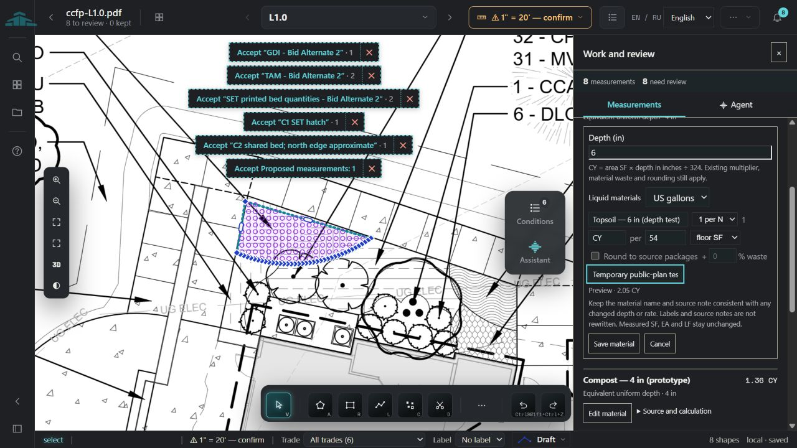
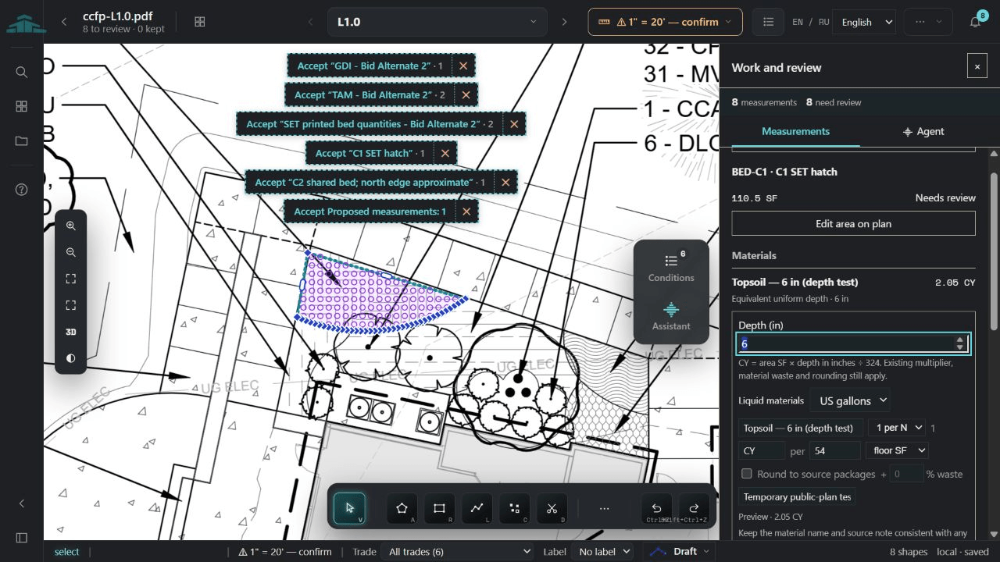

# Editable material depth in inches

In **Area assembly → Edit material**, enter **Depth (in)** to preview and save
CY directly. Topsoil and compost remain separate existing assembly rows.
The editor converts depth to the existing rate (`per = 324 / inches`), so
reports, project archives and saved recipes keep using the native calculation.
No depth field or extra quantity record is persisted.

Fork-only follow-up to the [area assembly panel](../area-assembly-panel/README.md),
on `codex/area-assembly-prototype`, based on `b2ec372`. No new PR, deployment,
CLG skill/memory, private plan or catalog data. The branch still inherits the
earlier planting and Area grid count prototypes.



## Public-plan checks

The [public source manifest](../planting-suite/source.json) identifies CCFP
Nature Center Addendum 1, PDF page 58, L1.0. The existing C1 outline is 110.5 SF.
Layer depths are **test assumptions**, not source-verified requirements. The
original calibration stays unconfirmed and no review button is used.

| Check | Expected | Observed |
| --- | --- | --- |
| Original 4-inch layers | 1.36 CY each | Unchanged on opening and after Cancel |
| Topsoil depth 6 inches | 110.5 × 6 / 324 = 2.05 CY displayed | 2.05 CY; existing row ID |
| Compost depth 2.5 inches | 110.5 × 2.5 / 324 = 0.85 CY displayed | 0.85 CY; existing row ID |
| Zero depth | No saved rate or valid preview | Save disabled; Preview · Not figured |
| Reload and archive reopen | Both edited rates persist | Exact JSON equality |
| Plant EA / edging LF | 127 + 58 SET EA / 48.17 LF unchanged | All eight shape records exactly equal |
| Bundled AF101 assumed 128 SF zone, 8-inch preview | 3.16 CY | 3.16 CY; Cancel restores exact project |

The test copy also explicitly edits each material's name and note to match the
new depth. The app does **not** rewrite free-text labels or source notes; the
editor explains this. The delivered 4-inch example and original live workspace
are restored after testing. A changed depth never silently revises a drawing
specification, plant count or acceptance decision.

## Mixed-plant bed

Use one shared outline, one set of area-based layers and separate EA source
rows for each plant code. Each row keeps its own quantity, source location and
review state. The same panel can list all explicitly linked records; no grid
or species allocation is needed just to retain printed quantities.

For the public east C2 bed, the
[source crop](../planting-suite/screenshots/source-callout-east.png) shows **eight**
codes: ACD, CPE, CPN, ERA, HAC, PHD, POR and SET. The saved example currently
links only the existing **58 SET** record. The other seven have not been
recorded, and this depth change does not add them. C2 also has no saved soil
rows or derived edging run yet; its north boundary remains approximate.
[The actual C2 panel](05-mixed-bed-existing-source.jpg) shows that current state.
This is not presented as a complete mixed-bed takeoff.

A separate synthetic six-source unit test verifies that changing a layer depth
preserves every linked EA and alternating review state. Those fixture counts
are not public-plan measurements or additions to the user's project.

## Evidence and reproduction

Tested in the Codex in-app browser, existing tab 6 at
`http://127.0.0.1:5200/`, default 1280 × 720 viewport, Vite production preview.
[verification.json](verification.json) identifies the loaded asset and checks.
The hosted OpenTakeoff app was not updated.



The short recording uses consecutive browser captures during actual input,
slowed for readability. [recording.json](recording.json) includes timestamps;
there is no review-speed claim. Other changed states:
[invalid depth](01-invalid-depth.jpg),
[fractional depth](03-compost-fractional-preview.jpg),
[saved/reopened values](04-reopened-depths.jpg),
[bundled sample editor](06-bundled-depth-preview.jpg).

1. Back up the current JSON, `.otk` archive and profile. Open the existing
   public bed archive from the [panel example](../area-assembly-panel/README.md).
2. Select **BED-C1 → Area assembly → Edit material**. Enter zero, verify Save
   is disabled, then Cancel and compare the export with the baseline.
3. Enter 6 inches for topsoil and 2.5 for compost, update their free-text labels
   and notes to identify the test assumptions, and save each row.
4. Export, reload, export, reopen the `.otk` and export again. Compare the
   complete JSON; only the explicit material patches and condition timestamp
   may differ from the baseline. Check the existing mixed-bed source too.
5. Exercise the depth input on the bundled `demo/sample-finish-plan.pdf` using
   the existing assumed demonstration zone. It is a UI smoke test, not soil
   work specified on the finish plan. Cancel and compare the entire project.
6. Restore the original live archive. Compare JSON, profile (excluding export
   timestamp) and all stored PDF bytes against the fresh backups.

```sh
node --import ./web/node_modules/tsx/dist/loader.mjs --test web/test/areaAssembly.test.ts
node --import ./web/node_modules/tsx/dist/loader.mjs docs/evidence/area-assembly-depth/verify.mjs
npm run check --prefix web
npm run check:tool-count --prefix mcp
npm run check:wiki --prefix mcp
npm run check --prefix protocol
node scripts/check-doc-links.mjs
```

`verify.mjs --browser` additionally verifies local fresh backups in
`tmp/area-assembly-depth`; these backups stay outside Git. Public test exports
are committed for reproducible comparisons.

## Deliberate limits

Depth entry is available for area coverage rows measured in CY; other units
and rules retain their existing editor. Only positive finite depths with a
finite positive converted rate can be saved. Native condition multiplier,
material waste and package rounding are preserved. No density, compaction,
bulking or additional allowance is inferred. Rates retain full numeric
precision; the existing totals engine controls display rounding.

No coordinate path, geometry, source relationship, machine original or review
state changes. The earlier panel's shared-condition/family write guards remain.
Mobile layout, estimator preference and real review speed remain unverified.
