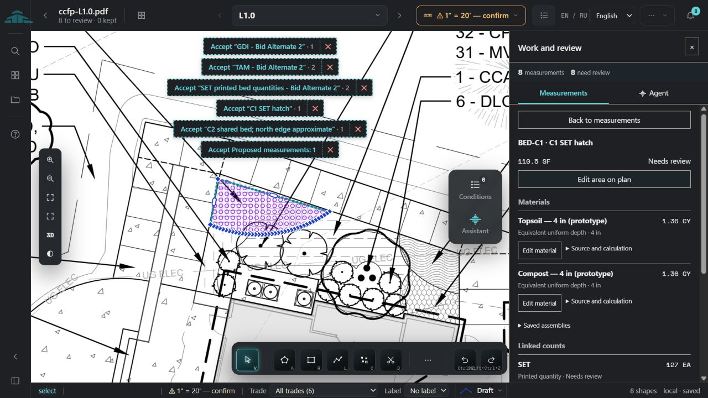
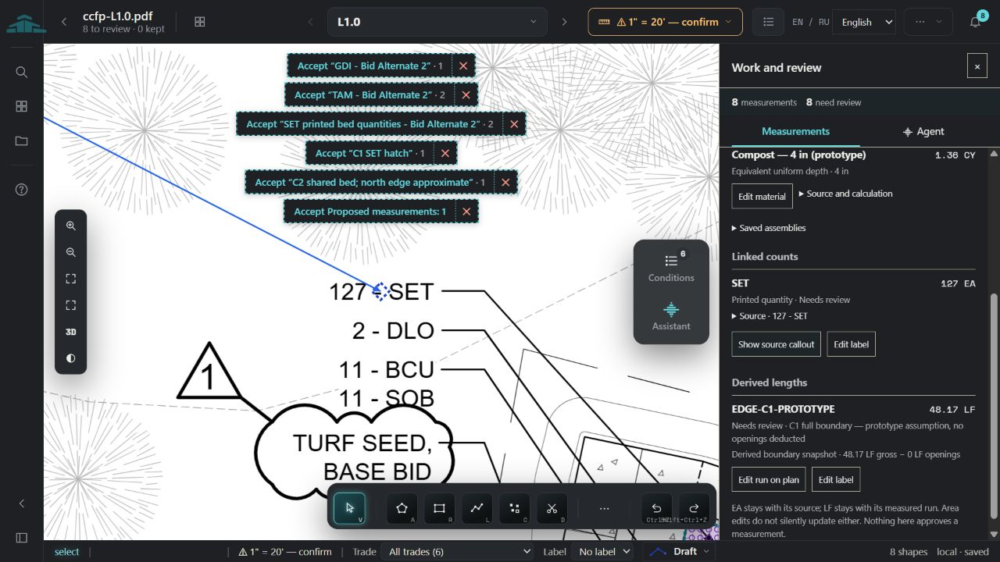
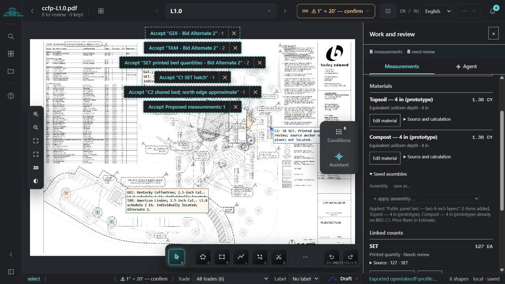

# Area assembly panel — fork prototype

The [depth-field follow-up](../area-assembly-depth/README.md) adds direct inch
entry to these existing material rows. The captures below document the panel
before that follow-up.

Open one bed to review its topsoil, compost, printed plant EA and edging LF.
Edit the existing material rows with preview, Save and Cancel. Locating the
plant source or edging keeps the bed panel open. No extra measurements or
quantity overrides are created.

This is a local browser change on `65monroe/opentakeoff`, branch
`codex/area-assembly-prototype`. No new PR, upstream change or deployment is
part of this work. The hosted app does not receive a local build automatically.
The branch inherits the planting and Area grid count prototypes; this increment
starts at `1d842ad77f56822b83d586acc3339d4e02691e22`, not upstream `main`.





## Scope and existing assemblies

The earlier [native assembly prototype](../area-assembly-prototype/README.md)
established the records and calculations. This follow-up adds a view over them:

- Material rows use `MaterialsEditor`, `AssemblyBar`, the existing condition
  update/family logic and `conditionTotals`. A material edit targets the bed's
  condition ID even after navigation selects the plant or edging condition.
- Plant EA uses `source_callout_ids` and the existing printed quantity record.
  A shared source is disclosed without allocating its count to each bed.
- Edging uses `origin.derived.from_shape_id` on the existing linear run. Its
  stored length, source and review state remain separate from material CY.
- Measurement labels use the existing shape command. Geometry edits remain
  the normal canvas grips. No new persisted fields, format migration or MCP
  tools are introduced. Opening, locating, cancelling and reapplying the same
  recipe do not modify existing quantities or review decisions.

This provides a concrete UI experiment relevant to
[#583 — parameterized assemblies](https://github.com/Kentucky-ai/opentakeoff/issues/583)
and [#617 — sitework and paving](https://github.com/Kentucky-ai/opentakeoff/issues/617),
with the planting example related to
[#659](https://github.com/Kentucky-ai/opentakeoff/issues/659).
It does not implement nested assemblies, parameter expressions or the full
sitework proposal. Before a new upstream panel PR, seek agreement on this
specific UI scope as CONTRIBUTING.md requests; no agreement is claimed here.

## Source and expected quantities

The public CCFP Nature Center Addendum 1, PDF page 58, sheet L1.0, supplies
the planting geometry and printed `127 - SET`. The
[source manifest](../planting-suite/source.json) records the public URL,
revision and PDF hash. The
[extraction instructions](../area-assembly-prototype/README.md#reproduce-and-check)
keep the full source PDF outside Git.

The two 4-inch layers and full-boundary edging are **prototype assumptions
requested for this test**, not requirements verified on L1.0. The existing
grid demonstration remains independent of the printed count. No CLG skill,
memory, private plan or private catalog is used in this follow-up.

| Output | Before / delivered | Temporary edit test | Source or calculation |
| --- | ---: | ---: | --- |
| Bed area | 110.5 SF | 110.5 SF | Existing editable C1 area |
| Topsoil, 4 inches | 1.36 CY | 1.36 CY | 110.5 / 81; no waste or compaction |
| Compost, 4 inches | 1.36 CY | 1.71 CY at 5 inches | 110.5 / 64.8 in test copy only |
| SET printed quantity | 127 EA | 127 EA | Existing C1 printed record |
| Other SET callout | 58 EA | 58 EA | Existing C2, not pulled into C1 panel |
| Edging | 48.17 LF | 48.17 LF | Existing full-boundary run; zero openings |

All eight shape records, six condition IDs and existing material row IDs are
preserved. The 5-inch test changes only one material's name, rate, note and
the owning condition timestamp. The delivered example returns to 4 inches.

## Design options and recommendation

The review task is to check one area's several outputs, inspect the source
or geometry, then adjust a material assumption without losing that area.

| Option | Review behavior | Tradeoff |
| --- | --- | --- |
| A — existing separate controls | Open the condition's Materials, then find the count and linear receipts | No new UI, but repeated context switching; materials and sources are not together |
| B — append everything to the receipt (considered, not built) | Keep list and full receipt visible while adding all editors | The receipt already contains geometry and grid controls and occupies only part of the panel |
| C — dedicated area view (**implemented recommendation**) | Open from an existing area/source/run, keep area context during navigation, expand a single editor | One extra entry/back gesture and vertical scrolling; avoids another permanent sidebar |

[The receipt before opening the panel](01-receipt-before-opening.jpg) shows
why extending that receipt would make this task denser. C is recommended for
this prototype because it reuses the existing controls while giving one area
the panel's available height. A/B are comparisons, not claimed working
implementations of alternative new panels. Estimator preference and review
speed remain unverified.

## Actual browser evidence

Tested in the Codex in-app browser, existing tab 6,
`http://127.0.0.1:5200/`, default 1280 × 720 viewport. The Vite production
preview serves the fork build; [verification.json](verification.json) records
the loaded asset and SHA-256. No public hosted build was changed.



The recording uses consecutive browser captures during the real UI actions.
Playback is slowed for readability, not a timing comparison; timestamps and
actions are in [recording.json](recording.json).

1. Back up the live JSON, project archive and profile before loading the public
   prototype archive. A second tab is not a separate saved workspace.
2. Select **BED-C1 · C1 SET hatch → Area assembly**. Verify both 1.36 CY rows,
   127 EA and 48.17 LF. Click **Edit area on plan**.
3. Click **Show source callout**, then **Edit run on plan**. The correct
   existing objects are selected; the area panel remains available. See
   [source](03-source-keeps-bed-context.jpg) and
   [edging](04-edging-keeps-bed-context.jpg).
4. Edit compost's coverage to 64.8. Cancel and export: the entire project is
   equal to the prototype baseline. Then locate the plant source and repeat
   the edit with the 5-inch name and note. Preview is 1.71 CY; Save changes
   the bed material, not the active plant condition. See
   [editor](05-edit-preview.jpg).
5. Export JSON and `.otk`, reload, export again, reopen the saved `.otk` and
   export again. All three edited exports agree exactly. Reopen the panel:
   [persisted result](06-edited-after-reopen.jpg).
6. Restore the 4-inch prototype. Save its two-row recipe with the native
   assembly controls and reapply it: **0 items added**. Export equals the
   baseline. See [repeat application](07-existing-assembly-repeat.jpg).
7. On the bundled `demo/sample-finish-plan.pdf`, reuse the existing 128 SF
   assumed demonstration zone. Apply the saved recipe: 1.58 CY per row.
   No plant counts or lengths are inferred. Preview a 5-inch compost rate:
   1.98 CY, then Cancel. See [bundled panel](09-bundled-assembly.jpg) and
   [native editor controls](10-bundled-edit-preview.jpg). This zone and recipe
   are a UI smoke test, not work specified on the finish plan.
8. Remove only the test recipe and restore the live archive. Compare the
   original JSON, profile (excluding export timestamp) and every stored PDF's
   bytes. No review button is used.

## Reproduce the checks

```sh
node --import ./web/node_modules/tsx/dist/loader.mjs --test web/test/areaAssembly.test.ts
node --import ./web/node_modules/tsx/dist/loader.mjs docs/evidence/area-assembly-panel/verify.mjs
npm run check --prefix web
npm run check:tool-count --prefix mcp
npm run check:wiki --prefix mcp
npm run check --prefix protocol
node scripts/check-doc-links.mjs
```

The committed exports contain public test data only. `verify.mjs --browser`
also checks local fresh backups/restoration and packages the deliverable
`tmp/area-assembly-panel/public-bed-panel.otk`; those live backup files stay
outside Git. The existing [MCP replay](../area-assembly-prototype/replay.mjs)
reproduces the original assembly/linear records. This follow-up tests the
browser view; it does not claim a new MCP takeoff or remeasure the bed.

Five focused tests cover exact native totals/no mutation, missing/shared and
cross-sheet links, wider condition/family scope, stale derived geometry and
invalid material rates. Browser exports also prove Cancel, explicit owner
selection, repeat application, reload, reopen and original restoration.
Required gate results are recorded in [verification.json](verification.json).

## Reviewer notes and limits

- No coordinate conversion is added. Shapes retain normalized sheet vertices;
  existing Show on plan and drawing commands handle framing and edits.
- Material recipes apply at condition scope. This bed-focused editor disables
  writes for a condition used by more than one measurement or in a material
  family; use the existing condition editor to see that scope.
- The panel exposes the existing rate editor, not a new thickness parameter.
  It shows an equivalent depth for CY coverage rows. Names and source notes
  do not update themselves when a rate changes. Existing liquid-unit controls
  remain in the shared editor even for a dry material.
- Plant EA has no new free-number override. It remains an existing source
  record, with source navigation and an editable label. Edging is edited on
  the plan; it is not inferred by a linear material row on an area.
- A derived run is a snapshot. Boundary mismatch warns; there is no automatic
  regeneration, inferred deductions, new review or duplicate geometry.
- Same-footprint layers can also illustrate bioretention materials. Different
  extents, side slopes or trench sections need their own geometry and stated
  dimensions; this panel does not calculate those automatically.
- Desktop browser tested; narrow/mobile layout and human review speed are
  unverified. The existing proposal banners remain visible in these captures.
  No customer plans, catalog data or acceptance decisions are part of the evidence.
