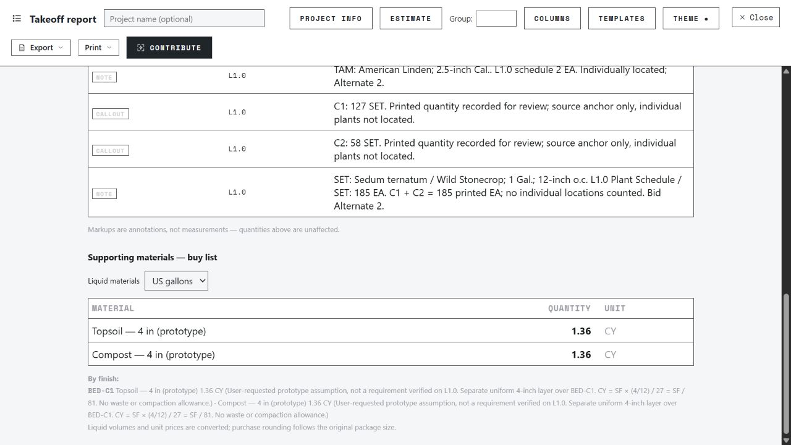

# Public bed: native assembly prototype

One existing public bed supplies two separate 4-inch material layers, its
existing printed plant quantity, and a pending edging run. The soil recipe uses
OpenTakeoff's existing assemblies. This increment changes example data and
documentation, not application code, schemas or MCP tools.

Fork branch: `codex/area-assembly-prototype`, based on `ec47b316` from
`codex/area-grid-count`. It inherits the earlier planting-source/area-grid
prototype; it is not an independent patch against upstream main. No new PR,
upstream push, production deployment or CLG skill/memory was used.

| Output for BED-C1 | Before | Expected / observed |
| --- | --- | --- |
| Existing bed area | 110.5 SF | 110.5 SF, unchanged |
| Topsoil, separate 4-inch layer | No material row | 1.36 CY |
| Compost, separate 4-inch layer | No material row | 1.36 CY |
| Existing SET callout C1 | 127 EA printed | 127 EA, unchanged |
| Full-boundary edging | No edging measurement | 48.17 LF, one new pending run |
| Other SET callout C2 | 58 EA printed | 58 EA, unchanged; total SET stays 185 EA |

Both depths and full-perimeter edging are **user-requested prototype
assumptions, not requirements verified on this plan**. No waste, compaction,
bulking, density, prices or openings are assumed. The original calibration
remains unconfirmed and all original review decisions remain intact.



The follow-up [Area assembly panel](../area-assembly-panel/README.md) brings
these existing records into one browser view. The evidence below records the
native workflow before that panel was added.

## Existing capability versus remaining work

The two soil rows are a native assembly: **1 CY per 81 SF** each, with package
rounding off. Each layer uses `CY = SF × (depth inches / 12) / 27`. At 4 inches,
`27 / (4/12) = 81`, so `110.5 / 81 = 1.3641975…`, displayed as **1.36 CY per
material**. These are separate layers, not a blended soil specification or a
doubled bed area.

The existing SET measurement remains the source of **127 EA**. Its linked
planting area provides location. A new plant coverage row would duplicate the
quantity or invent a density. The existing grid preview remains **110
positions**, unchanged, and does not replace the printed 127 EA.

The existing MCP `derive_base` tool supplies the new edging line from the bed's
whole outline. Its `origin.derived.from_shape_id` points to the original bed.
This reuses a wall-base derivation for a stated full-boundary prototype, with
no openings deducted. It produces a separate linear record, not another area.
The report displays 48.2 LF; the editable record/MCP report retain 48.17 LF.

**This is not yet one assembly containing all four outputs.** The native
assembly stores the two soil rows. The linked plant count and derived edging
remain separate reviewable measurements. There is no new unified multi-measure
panel, depth-input control, nested kit or dependency engine in this increment.

| Approach considered | Consequence | Decision |
| --- | --- | --- |
| Native recipe + source count + derived perimeter | Supported records; several review surfaces | Tested here |
| Duplicate bed or one condition height for both layers | Duplicates SF or cannot express independent material depths | Not used |
| Parameterized kit with area, count and boundary inputs | Could unify editing/review; needs #583's design | Follow-up |

## Public source and preservation

[Source manifest](../planting-suite/source.json): public CCFP Nature Center
Addendum 1, PDF page 58, sheet L1.0, revision 02.11.2026, Bid Alternate 2.
[Public source PDF](https://www.champaignforests.org/Portals/0/adam/Content/6doWEpGR10S4Upy-igoSYw/Link/_26_0216_CCFP%20Nature%20Center%20Addendum%20No%201.pdf).
The [schedule crop](../planting-suite/screenshots/schedule-set.png) identifies
SET as Sedum ternatum / Wild Stonecrop, 1 Gal., 12 inches o.c. It does not
establish topsoil, compost, edging or container diameter.

This continues the already measured public bed, without rerunning its takeoff.
[baseline.json](baseline.json) is the fresh browser export. All seven existing
shapes remain structurally identical, including IDs, vertices, computed
quantities, provenance, grid assumptions, source links and review flags.
All five condition IDs remain. BED-C1 gains only two material rows and the
browser's normal `updated_at` timestamp. The new edge has its own new condition
and measurement IDs, recorded in [prototype.takeoff.json](prototype.takeoff.json).
Original C2 data, annotations and scale records are unchanged.

## Connections to existing proposals

- [#583 — parameterized, nested assemblies](https://github.com/Kentucky-ai/opentakeoff/issues/583):
  a baseline for independent depths and multiple measurement inputs. This does
  not claim that its parameters, expressions, nesting, revision snapshots or
  proposed MCP assembly tools exist today.
- [#617 — sitework and paving](https://github.com/Kentucky-ai/opentakeoff/issues/617):
  separate area × thickness courses, CY, and LF × stated width × depth trench
  volumes fit this scope. Plant identities and count sources coordinate with
  [#659 — planting suite](https://github.com/Kentucky-ai/opentakeoff/issues/659).
- [#651 — earthwork and section views](https://github.com/Kentucky-ai/opentakeoff/issues/651):
  relevant to trenches, varying sections and excavation/backfill. The trench
  cross-section comment on #617 is a question, not an agreed standard section.

Bioretention beds/bio ponds can reuse this pattern for soil, sand and stone
layers **when their horizontal extents are the same**. Different layer extents,
sloping sides or variable depths need additional geometry or sections. A
uniform rectangular trench uses `CY = LF × width ft × depth ft / 27` per
material; different layers need separate dimensions, with any displacement or
exclusions stated. No bioretention or trench section was measured or designed
in this trial.

## Open and review

The local deliverable is `tmp/area-assembly/public-bed-assembly.otk`, containing
the public L1.0 PDF and browser-tested takeoff. The fork carries editable JSON,
the reusable [recipe](assembly.json), source link and replay commands; it does
not redistribute the full public PDF.

1. Export your current project archive. **Open plans** and choose the example
   `.otk`. Full-project loading replaces the takeoff workspace; another tab on
   the same origin is not a separate saved workspace.
2. **Work and review → SET 127 EA → Show on plan** locates the linked bed.
   The receipt retains the printed-count basis; expand **Source · 127 - SET**
   for the callout. No grid positions become EA.
3. Select `EDGE-C1-PROTOTYPE` → **Show on plan**. Inspect the boundary and
   pending 48.17 LF receipt. Its label states the prototype scope.
4. **⋯ → Takeoffs table — library, materials, columns → BED-C1 → Materials**
   shows two CY rows at 81 SF/CY. **Assembly → save as…** saves the recipe in
   your own library. Applying it again skips the two existing material names.
5. **Quantities report** shows SF/EA/LF. Scroll to **Supporting materials —
   buy list** for CY. The SET condition total is 185 EA because the other
   original 58-EA callout remains in the project.
6. Export takeoff and project archive; reload or reopen after another project.
   Verify the quantities and pending review states again.

The report screenshots use the supported importable
[light report theme](report-theme.json): the default report had dark text on a
dark background in this browser. This affects presentation only. The original
theme and library were restored. Save the recipe through **save as…** rather
than replacing your entire `.otprofile`.

## Evidence

Tested in Codex in-app tab 6, `http://127.0.0.1:5200/`, 1280 × 720, entry
`assets/index-CUr_kt_-.js`, SHA-256
`0c52e054bbf3aed93a380df1f0d70fe344b768342ce97f5642fe4da1a398d903`.
[Build observation](browser-build.json). The public hosted app was unchanged.

| Check | Evidence |
| --- | --- |
| Bed: Show on plan from overview | [Selected bed](screenshots/bed-show-on-plan.jpg) |
| Save native assembly | [Controls](screenshots/assembly-saved.jpg), [recipe](assembly.json) |
| Apply to empty material list: 2 added; repeat: 0 | [Repeat application](screenshots/assembly-repeat-skip.jpg), [checks](verification.json) |
| Existing printed 127 EA and linked area | [Plant receipt](screenshots/plant-show-on-plan.jpg) |
| New pending 48.17 LF at the same boundary | [Edging receipt](screenshots/edging-show-on-plan.jpg) |
| Separate units | [SF/EA/LF](screenshots/report-quantities.jpg), [CY](screenshots/report-layers.jpg) |
| Reload: export exactly equal | [Reload JSON](after-reload.json) |
| Original 7-shape project loaded, then saved 8-shape archive reopened | [Reopen JSON](after-reopen.json), [report](screenshots/report-reopened.jpg) |
| Real stdio MCP calls | [Transcript](mcp-transcript.json), [report](mcp-report.json), [overlay](mcp-bed.png), [checks](mcp-checks.json) |
| Original project/profile/three PDF byte streams restored | [Verification](verification.json) |

These are actual-app screenshots with [timestamps](captures.json), not
mockups, continuous video or human review-speed evidence. No Accept, Mark
reviewed or scale confirmation was invoked. Fresh takeoff, archive and profile
backups remain under ignored `tmp/area-assembly/`.

## Reproduce and check

Node 24; install dependencies in `web/` and `mcp/`. From the repository root:

```sh
# Download the linked source PDF; extraction verifies its SHA-256/revision.
node docs/evidence/area-assembly-prototype/extract-sheet.mjs path/to/public-addendum.pdf
node docs/evidence/area-assembly-prototype/replay.mjs
node --import ./web/node_modules/tsx/dist/loader.mjs docs/evidence/area-assembly-prototype/verify.mjs
npm run check --prefix web
npm run check:tool-count --prefix mcp
npm run check:wiki --prefix mcp
npm run check --prefix protocol
node scripts/check-doc-links.mjs
```

Replay reads `takeoff://wiki`, loads the PDF, imports the baseline, then uses
`edit_materials`, `derive_base`, `edit_shape` (new edge label only),
`export_report`, `takeoff_summary`, `view_sheet`, `export_marked_pdf` and
`export_takeoff`. It checks Undo and invalid-opening refusal in an isolated
MCP session and writes an editable archive and marked PDF under ignored `tmp/`.
Fresh replays mint fresh test edge/material IDs; the delivered example's IDs
stay fixed. Do not merge repeated replay exports into a live job.

The fixture verifier reads committed browser exports and the actual
totals/assembly functions. It checks both 1.36-CY rows, 127 source EA, 48.17 LF,
duplicate prevention, and zero area → zero CY. A clone-only compost change to
5 inches gives 1.71 CY while topsoil stays 1.36 CY; no live record is edited.
A linear material directly on an area gives **0 LF**, demonstrating why the
derived edge is needed. `--browser` additionally checks fresh local backups,
reload/reopen and original PDF bytes; profile backups are not committed.

Validation on 2026-11-21: web check passed (3,854 passing tests, four skipped,
typecheck/lint/benchmark/build/OCR); protocol passed 64 tests, 11 schemas and
16 transport cases; inventory passed 71 default / 73 gated / 22 setup tools;
11 wiki pages matched. [Command results](validation.json) include doc links.

## Observed limits

- Recipes apply to a **condition**, not an arbitrary individual shape. BED-C1
  contains one area. A shared condition spanning unlike beds would apply its
  depths to all of them.
- Depth is coverage plus a note: `per = 324 / depth inches`. There is no new
  depth field. MCP/model inference must not guess missing specifications.
- Derived edging is a snapshot, not an automatically updated dependency.
  Boundary edits require deliberate edging revision; rerunning derivation
  without replacing the old run duplicates LF.
- Native derivation Undo restores original records but retains the new empty
  condition. Full archive restoration was verified.
- A legacy profile without `assembly_library` keeps the current library. The
  test recipe was explicitly removed before the final profile comparison.
- Parameterized/nested kits, mixed-species density allocation, varying-depth
  volumes, trench/bioretention sections and pricing remain follow-ups.
