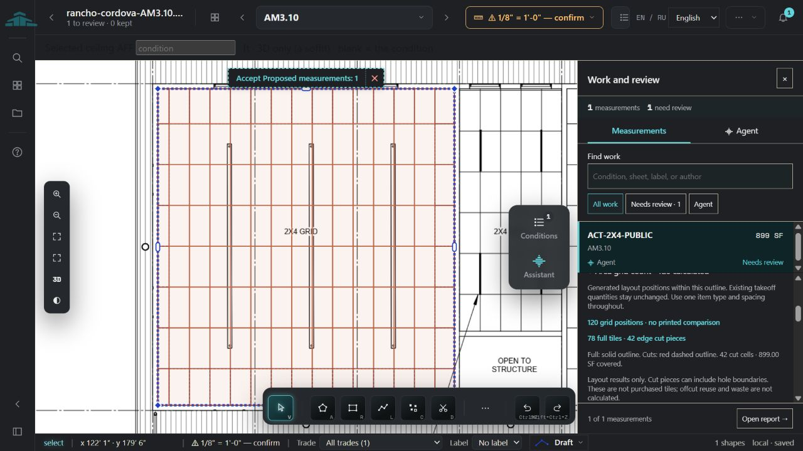

# Actual public 2-by-4 ceiling grid

Current compact-panel captures and cross-example scope:
[area review packet](../area-review/README.md). The source, arithmetic and
save/reopen records below remain the original dedicated test.

The generic **Area grid count** branch now has a source-backed rectangular
ceiling example. The printed **2X4 GRID** and its actual linework agree:
**78 full tiles + 42 edge cut pieces** in a **899 SF** bay. MCP alignment,
browser **Show on plan**, **Save grid**, reload and archive reopen pass.
The original project is restored exactly. This is fork-only evidence;
no new PR, application code, schema or suite change is made here.



## Source and independent arithmetic

Source: [Rancho Cordova Elementary School modular bid drawings, October 2, 2025](https://resources.finalsite.net/images/v1759442981/fcusdorg/flogfhqwzp1nqfsbrriz/251002_RCESmodularBidDwgs.pdf),
PDF page 11 of 14, **AM3.10, Unit M – Reflected Ceiling Plan**, west bay.
The sheet prints **1/8 inch = 1 foot** and labels this bay **2X4 GRID**.
The [unmarked source crop](source-bay.png) shows the complete tested bay;
[source text](text.json) and [sheet metadata](sheet-info.json) come from MCP.
This is a new source, separate from the earlier A111 square-grid example.

Original source SHA-256:
`280b4273458c9c8cc35f48c60809a496cc4f92582076e188112f8525c4b7c209`.
The PDF and editable `.otk` files remain local. Only public source excerpts,
measurement JSON, scripts and screenshots are committed.

| Check | Independent expectation | Observed |
| --- | --- | --- |
| Drawn spacing, X / Y | 36 / 72 image px at 18 px/ft | 2 / 4 ft |
| Distinct interior grid lines | 14 vertical, 7 horizontal | All 21 explained; maximum residual 0.24 px |
| Rows / columns | 8 rows × 15 columns | 120 intersecting cells |
| Full modules | 6 full rows × 13 full columns | 78 |
| Edge cuts | Top and bottom: 2 × 15; side pieces between them: 2 × 6 | 42 cells, 42 connected pieces |
| Area | 29 × 31 ft | 899 SF = 624 full + 275 cut SF |
| Perimeter | 2 × (29 + 31) ft | 120 LF |
| Grid centers inside | All 15 × 8 centers fall inside this particular boundary | 120; does not replace any stored quantity |
| Wrong 90-degree orientation | 4-ft X pitch misses alternating source lines | Only 7 of 14 X lines explained |
| Wrong half-module X shift | No source vertical on the shifted lattice | 0 of 14 X lines explained |

The room boundary uses the actual inner wall faces, image coordinates
`(2342.4,2990.64)` through `(2864.4,3548.64)`. MCP coordinates are PDF points
times two, origin top-left, Y down, on a 6048 × 4320 frame. Saved vertices and
grid origin are normalized; spacing and offsets are feet. Scale was explicitly
adopted through `set_scale use_detected` and remains **unconfirmed by a person**.

The source fit uses 39 visually selected stroke fragments, raw indices 157–195
in [vectors.json](vectors.json), to recover 21 distinct grid lines. It excludes
wall faces, clip/fill paths, lamps and exterior construction-grid bubbles.
The complete extraction ledger is 1000 returned, zero dropped. This is an
agent-assisted reading of actual `get_sheet_vectors` output, **not a shipped
automatic ceiling reader or a new MCP tool**.

The angle is 0 degrees, so the 4-ft module side runs down the sheet. The fixed
origin is the northwest wall face. Grid offsets describe **centers**, while
the PDF strokes describe **edges**: fitted offsets are approximately **1.12 in
X / 17.12 in Y**. The maximum line residual is 0.24 image px (0.16 real inches).
The [suggestion](suggestion.json) records the fit and exact saved inputs.
No quantity target is used to choose spacing or phase.

These are nominal ceiling modules, not physical tile-face dimensions. The
three long lights in this bay are labeled suspended direct/indirect on the
sheet and are not treated as removed full modules. Penetrations, support
hardware, fixture deductions in other rooms, waste and reusable offcuts are
not established by this test. No procurement quantity is claimed.

## What is preserved

This new public example was measured once through MCP `measure_polygon`
([creation transcript](creation-transcript.json)).
The previous A111 and SET records were not moved onto a different sheet.
[baseline.json](baseline.json) is the boundary before any grid settings;
[aligned.json](aligned.json) changes only `area_grid`.

- Measurement: `shp-531f70fb-c173-4e4e-80fc-ac3c8b66a39e`.
- Condition: `cnd-a136aad0-65bb-4f7c-8d5f-eead73ace18b`, `ACT-2X4-PUBLIC`.
- Four vertices, 899 SF, 120 LF, calibration and provenance remain identical.
- Pending review remains pending. No **Accept**, **Mark reviewed** or scale
  confirmation was invoked. The MCP quantity report is unchanged; Undo is exact.

Before browser testing, the live takeoff and full project archive were exported.
Afterward, all seven original measurements and five conditions were restored,
with complete JSON equality and all three original PDFs byte-identical.
The added public test PDF was removed from that live plan set after exporting
the example; it remains available in its separate local archive.

## Browser evidence

Tested in the existing Codex in-app browser, tab 6,
`http://127.0.0.1:5200/`, 1280 × 720. The actual loaded entry was
`assets/index-CUr_kt_-.js`, SHA-256
`0c52e054bbf3aed93a380df1f0d70fe344b768342ce97f5642fe4da1a398d903`.
This does not update the public hosted app.

1. Load the isolated example archive. Select `ACT-2X4-PUBLIC`, click
   **Fit sheet to view**, then **Show on plan**. Check the correct sheet, bay,
   selection boundary and surrounding context.
2. Inspect Rectangular, 24/48-inch spacing and nominal footprint, 0 degrees,
   zero clearance and the source-derived center shifts. Click **Save grid**.
3. Export takeoff and full archive. Reload the page, select the same record,
   repeat **Show on plan** and export again.
4. Load the boundary-only baseline archive: the drawn source grid remains,
   but the colored layout overlay disappears. Reopen the browser-exported
   archive and repeat **Show on plan**. Verify 78 full / 42 cuts and export.
5. Compare all fields, then restore and verify the pre-test live project.

| Evidence | Link |
| --- | --- |
| Whole-sheet starting view | [Overview](overview.jpg) |
| Selected bay reached from overview | [Show on plan](show-on-plan.jpg) |
| Pattern / angle and editable shifts | [Controls](alignment-controls.jpg), [offsets](offset-controls.jpg) |
| Saved full/cut results | [Saved](saved-results.jpg) |
| Page reload | [Reloaded](after-reload.jpg), [JSON](after-reload.json) |
| Different state loaded before reopening | [Baseline without grid](baseline-without-grid.jpg) |
| Archive reopen | Screenshot above; [JSON](after-reopen.json) |
| Real MCP calls and result | [Transcript](transcript.json), [overlay](mcp-aligned.png), [result](result.json) |
| Current static PDF limitation | [Rendered export crop](boundary-export.png): boundary and hatch, no derived grid/cut overlays |
| Exact persistence and negative guards | [Verification](verify.mjs), [checks](checks.json) |

The saved, reloaded and reopened JSON documents are exactly equal. The only
view-state difference from MCP export is adding AM3.10 to `sheet_tabs`.
These are actual step screenshots with [capture times](captures.json), not a
continuous recording or a review-speed study. No UI flow changed in this update;
the branch's [existing control-flow recording](../area-grid-rectangles/README.md#browser-evidence)
and [public planting recording](../area-grid-count/README.md#public-example-and-actual-app-recording)
remain supporting evidence. The shift inputs currently expose excess decimal
digits; persisted values are exact, but display formatting remains a UI follow-up.

## Reproduce and open

Download the linked original PDF to
`tmp/area-grid-actual-2x4/rancho-cordova-source.pdf`, then run from repo root:

```sh
node docs/evidence/area-grid-actual-2x4/prepare-source.mjs
node docs/evidence/area-grid-actual-2x4/replay.mjs
node docs/evidence/area-grid-actual-2x4/verify.mjs
npm run check --prefix web
npm run check:tool-count --prefix mcp
npm run check:wiki --prefix mcp
npm run check --prefix protocol
node scripts/check-doc-links.mjs
```

Replay imports the recorded baseline and reuses its IDs, then reads the actual
MCP source vectors and applies the grid through `edit_shape`. It creates
`tmp/area-grid-actual-2x4/replay/public-actual-2x4.otk`. Export your current
project archive first, then use **Open plans** to load that file. Open AM3.10,
select `ACT-2X4-PUBLIC` in **Work and review**, and click **Show on plan**.
An archive replaces the takeoff; this is not a JSON-merge test.

## Scope and reviewer notes

This belongs to **Area grid count**, a shared geometry capability. Related:
[planting suite #659](https://github.com/Kentucky-ai/opentakeoff/issues/659) and
[ceiling layout #661](https://github.com/Kentucky-ai/opentakeoff/issues/661).
Neither issue is closed or fully implemented by this example. The SET bed is
verified as a spacing comparison, preserving printed 127 EA separately from
110 square / 129 triangular positions; it is not proof of every planting task.
The ceiling issue also requests balanced borders, fixtures, runners, hangers,
specific Hendersonville evidence and 3D presentation. Lattice-as-wall detection
[#653](https://github.com/Kentucky-ai/opentakeoff/issues/653) is separate.

The next useful work is to expose these derived grids/cuts in marked-PDF export,
and exercise fixture openings and minimum-border checks on a public ceiling.
Static `export_marked_pdf` currently preserves the measured boundary but omits
derived grid/cut overlays; this is disclosed, not presented as a completed
marked-grid export. Paver joints/bonds, offcut reuse, runner/hanger assemblies
and multiple calculations per boundary should remain follow-ups with their
own source-backed examples rather than enlarging this contribution now.

Previous public SET/A111 evidence and the maintainer's #655/#661 answer-key
discussion were read for context. This bay's boundary, spacing and hand count
were derived fresh from AM3.10; those prior quantities did not supply its answer.
No CLG skills, memory, customer plans, catalog data or company scripts were used.
Human preference, review speed, upstream CI and final maintainer acceptance
remain unverified. The existing branch dependencies and future PR split still
need to be stated when submitting; this update opens no PR or comment.
