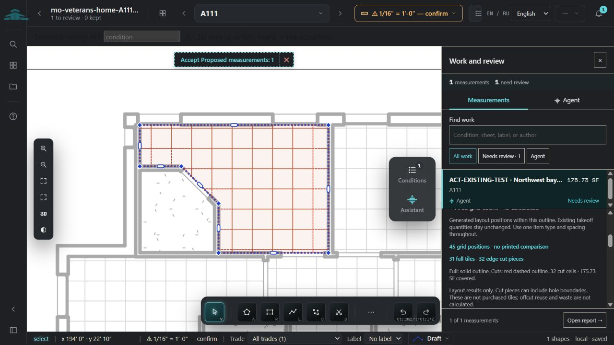

# Applied source-aligned ceiling example

The public A111 example now uses the [source-derived square alignment](../area-grid-source/README.md):
**2-foot pitch, 0 degrees, 1-foot X/Y center offsets and a nominal 2-by-2-foot
footprint**. It shows **31 full tiles and 32 edge cut pieces**. The browser's
**Show on plan**, **Save grid**, page reload and project-archive reopen all pass.
Saved area remains **175.73 SF**, perimeter remains **60.4 LF**, and review stays
pending. This is a fork-only example and evidence update; no app code or new PR.



The screenshot is from the actual local app. Full tiles use solid outlines and
cuts use red dashed outlines. These are calculated layout pieces, not purchased
tiles. The **45 calculated** value counts grid centers inside the boundary;
boundary-crossing modules can have centers outside it, so it does not equal
the sum of full tiles and cut pieces.

## What changed and what stayed fixed

| Field | Previous assumed 2-by-4 example | Applied drawn alignment |
|---|---:|---:|
| X/Y pitch | 2 / 4 ft | 2 / 2 ft |
| Angle and center offsets | 0 degrees; 1 / 1 ft | Unchanged |
| Nominal footprint | 2 by 4 ft | 2 by 2 ft |
| Calculated grid centers | 23 | 45 |
| Full tiles / edge cut pieces | 8 / 24 | 31 / 32 |
| Stored area / perimeter | 175.73 SF / 60.4 LF | Unchanged |
| Measurements / conditions | 1 / 1 | Unchanged |
| New approvals | 0 | 0 |

Only `area_grid` changes: square pattern, matching footprint and updated source
notes. Its original origin stays fixed. The ID
`shp-1db5dfa0-f9ae-489a-8bd3-0e4ec9ba067a`, condition ID, seven vertices,
calibration, stored quantities and provenance/review record are identical.
The existing rectangular examples remain available as separate alternatives.

The public source is the [St. Louis Veterans Home A111 reflected ceiling plan](https://oa.mo.gov/sites/default/files/bid-opportunities/_U2607-01%20-%20Final%20Plans.pdf).
The [source experiment](../area-grid-source/README.md#public-source-and-result)
records the PDF hash, raw lines, coordinate frame and fit tolerance. The drawn
grid supports this alignment, but the legend permits 2-by-2 or 2-by-4. Physical
face size, joints, main-runner direction and procurement size remain unverified.
The footprint remains **Assumed** and the scale remains unconfirmed.

## Browser test and evidence

The test uses the existing Codex in-app browser tab 6 at
`http://127.0.0.1:5200/`, 1280 by 720. The loaded entry is
`assets/index-CUr_kt_-.js`; [checks.json](checks.json) records its hash.
It does not change the hosted app.

1. Export the current browser takeoff and full archive before loading the
   example. Verify the archive contains all three PDFs and the exact seven
   original records.
2. Load the aligned example archive, open A111 and select the existing record.
   Click **Fit sheet to view**, then **Show on plan**. The correct bay becomes
   centered and selected with surrounding drawing context.
3. Inspect **Square**, 24-inch spacing and footprint dimensions, 0-degree angle
   and 12-inch X/Y shifts. Click **Save grid**, then export takeoff and archive.
4. Reload the page and repeat **Show on plan**. Export the takeoff again.
5. Load the old 2-by-4 archive and verify its 8 full tiles and 24 cuts. Reopen the
   browser-exported aligned archive; verify A111, 31 full tiles and 32 cuts,
   pending review and **Show on plan**. Export again.
6. Restore the original browser backup and compare complete JSON equality.
   No **Mark reviewed**, **Accept**, scale confirmation or geometry edit occurs.

| Evidence | Link |
|---|---|
| Whole-sheet view before locating | [Overview](sheet-overview.jpg) |
| Located bay with surrounding context | [Show on plan](located-bay.jpg) |
| Square pattern, spacing and angle | [Controls](alignment-controls.jpg) |
| 12-inch X/Y center offsets | [Offsets](offsets.jpg) |
| Reopened full/cut results and pending review | Screenshot above; [results](reopened-results.jpg) |
| Actual MCP edit and unchanged report | [Transcript](transcript.json), [MCP overlay](mcp-aligned.png) |
| Saved/reload/reopen persistence | [Executable assertions](verify.mjs), [saved](browser-saved.json), [reloaded](after-reload.json), [reopened](after-reopen.json) |

Browser exports are exactly equal after save, reload and archive reopen. Opening
A111 adds its active-sheet tab to the MCP export's initially empty `sheet_tabs`;
that is the sole browser view-state difference. Every other field matches the
MCP result. MCP Undo restores the exact [before record](before.json).
The live workspace's backup and restored JSON also match exactly; their hash
is recorded in the checks. Backups and PDF archives stay local.

These are actual step screenshots, with [capture times](captures.json), not a
continuous recording or review-speed study. No new UI flow is introduced; the
[existing grid-control recording](../area-grid-rectangles/README.md#browser-evidence)
remains supporting evidence. The public source, previous quantities and source
fit were intentionally reused. No CLG skills, memory, customer drawings or
private catalog data are used.

## Reproduce and open the editable example

Run from the repository root with web and MCP dependencies installed:

```sh
node docs/evidence/area-grid-aligned/replay.mjs
node docs/evidence/area-grid-aligned/verify.mjs
npm run check --prefix web
npm run check:tool-count --prefix mcp
npm run check:wiki --prefix mcp
npm run check --prefix protocol
node scripts/check-doc-links.mjs
```

The replay creates `tmp/area-grid-aligned/replay/ceiling-source-aligned.otk` with
the public PDF and editable takeoff. In OpenTakeoff, export your current project
archive first, click **Open plans**, and choose that file. Open A111 if the plan
gallery appears. Select **ACT-EXISTING-TEST** in **Work and review**, then click
**Show on plan**. An archive replaces the active takeoff; it does not merge it.

The verification compares the applied example with the earlier independent
exact-rational cut oracle, and refuses a deliberate measured-area mutation.
No schema migration, quantity adoption or automatic approval occurs. Static
marked-PDF exports still omit the derived grid and cuts. Local checks do not
establish human approval or upstream CI. No new PR, issue, comment, merge or
deployment is made.
