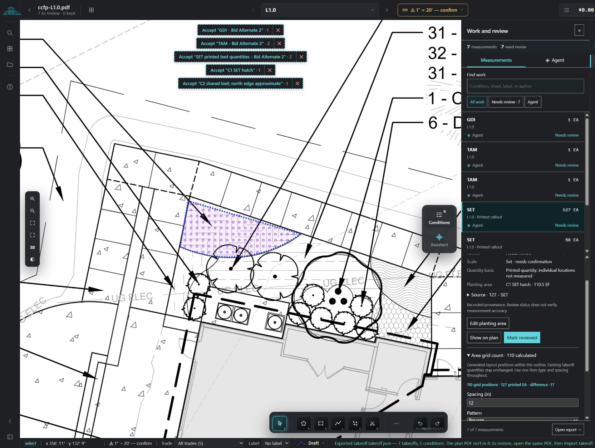
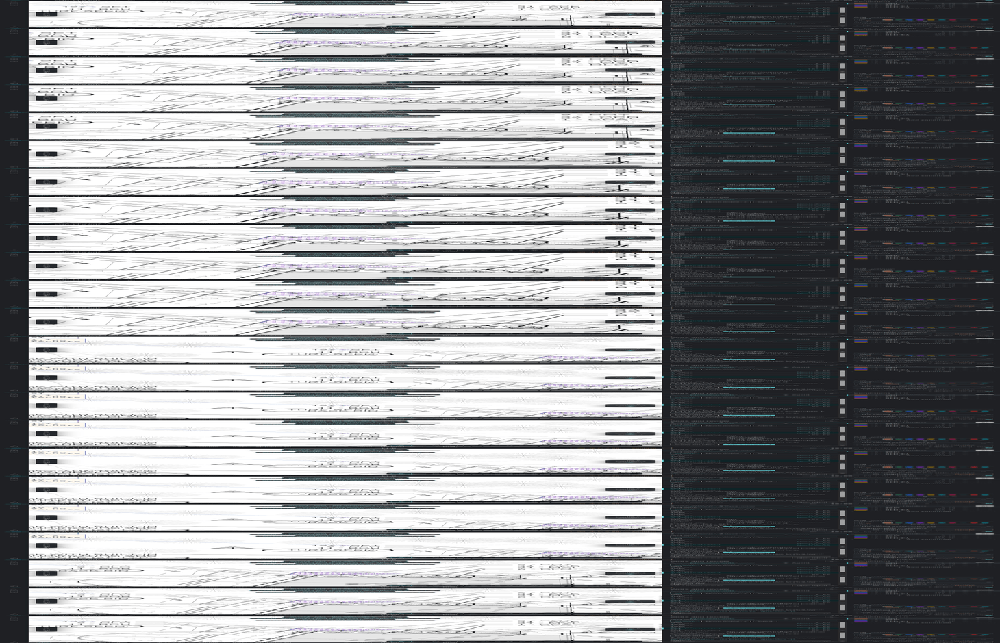
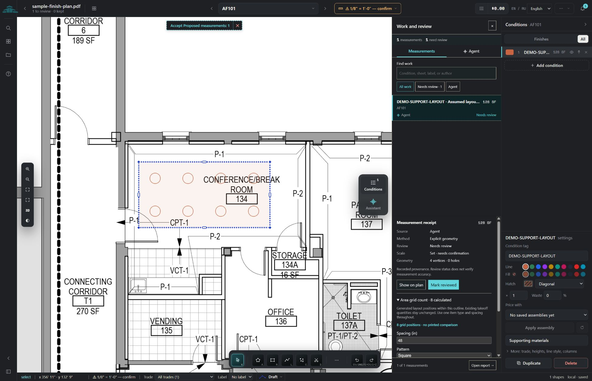

# Area grid count

Area grid count calculates repeated positions inside an editable area. It works
without a plant code or a printed quantity. Planting remains the first public
example; a bundled finish-plan demonstration exercises a generic layout with no
printed source. Calculated positions do not add EA or replace observed counts.

This work stays on the fork branch `codex/area-grid-count`. It continues the
planting-grid prototype at `1a0420c7aea7d64aca09db7c16bb72804a7d6d06`; no new PR,
production deployment, or upstream merge is part of this update. It still depends
on the earlier planting-suite/linked-area work. Keep that dependency explicit
when preparing a future separate PR.

## Public example and actual-app recording





The clip consists of 23 consecutive browser captures made concurrently with the
actual UI actions: zoom, open Source, Show source callout, return to the area.
Playback is slowed three times for legibility, with a final-frame hold. It is
not a mockup, a human timing study or a claim about review speed. Capture timing
and actions are in [recording.json](recording.json).

The [source manifest](../planting-suite/source.json) identifies the public CCFP
Nature Center Addendum 1 PDF, page 58, L1.0, revision 02.11.2026, Bid Alternate 2.
The [schedule crop](../planting-suite/screenshots/schedule-set.png) verifies SET:
Sedum ternatum / Wild Stonecrop, 1 Gal., 12 inches o.c. The previously traced
110.5 SF outline and printed quantities remain unchanged. Pattern, angle, shifts
and edge clearance remain explicit assumptions, not schedule requirements.
The public PDF is linked in the manifest; it is not committed to this branch.
No company skills, company memory, private drawings or catalog data were used.

| Scenario | Expected | Observed |
| --- | --- | --- |
| Existing SET square grid | Same inputs, same positions | 110; printed quantity 127 EA |
| SET triangular alternative through MCP | Same earlier result | 129; printed quantity 127 EA |
| Current browser project after save, Undo and archive reopen | Exact live backup | Complete JSON deeply equal; all seven records preserved |
| Explicit generic save | Replace layout metadata only | `area_grid` replaces `planting_grid`; every other project field unchanged |
| Mixed SET bed | Preserve 58 EA, 329.88 SF and source access | Preserved; no species-wide grid applied |
| Bundled AF101, assumed 16 × 8 ft layout zone | 4 × 2 generated positions at 4 ft spacing, 2 ft shifts | 8 positions; area stays 128 SF; no printed comparison |
| Bundled spacing changed to 8 ft | 2 × 1 positions; no area or review change | 2 positions; Undo restores 8 |
| Bundled Remove grid and Undo | Exact prior configuration | Restored; native archive reopen retains it |

The initial [baseline](baseline.json) was downloaded from the live browser
before changing the build. Native `.otk` backups containing the public PDF remain
local. The [export after reopening](browser-after-reopen.json) is exactly equal
to that baseline. [verify.mjs](verify.mjs) compares every field; it does not check
only totals. The [explicit-save export](browser-explicit-edit.json) demonstrates
the deliberate metadata conversion, then Undo restores the original field.

## Generic bundled-plan exercise



The bundled source is `demo/sample-finish-plan.pdf`, AF101, conference/break room
134. The rectangular **Assumed layout zone; not specified work** is a test zone
inside the room, not a measurement of the entire room or a claim that supports
are specified there. Its geometry and spacing are explicitly synthetic test
inputs on the real bundled drawing. No support quantities are inferred from the
finish schedule. The zone is 128 SF, with a separate generated-position display.

The MCP replay created the zone with `measure_polygon`, then configured
`edit_shape area_grid` without `source_callout_ids`, `source_callout_id`, a plant
code, or a printed quantity. The actual browser exercise changed spacing,
saved, undid, removed/undid, saved a native archive and reopened it. See
[edited layout](demo-grid-edited.jpg), [settings and assumptions](demo-settings.jpg),
[reopened layout](demo-reopened.jpg) and [browser export](demo-browser-after.json).
The original public planting project was restored afterward and rechecked.

The test used the existing in-app browser at `http://127.0.0.1:5200/` serving the
local Vite production build. An attempted separate origin on port 5201 was not
reachable from that browser; the test therefore used full `.otk` replacement
after backup, then restored the original. It did not rely on a merge or pretend
that another tab was an isolated saved workspace.

Flow tests and the recording used `assets/index-VQdkmIHT.js`, SHA-256
`1c95e2c6dd85a469544f5a683d89e1d8ef1ef88fd2094d2900f5ed9efffde616`.
The final build adds a disabled Save state for an unavailable linked source;
its entry and final browser smoke result are recorded in [checks.json](checks.json).
Neither build changes the public hosted application.

## Design choice and compatibility

Three approaches were considered:

1. Keep a planting-only feature. This fits the first example but prevents reuse
   for other repeated layouts.
2. Use generic labels but require a printed callout. This keeps a mandatory
   comparison at the cost of inventing a source record when no quantity is printed.
3. Use an area layout with an optional printed comparison. This is implemented.
   The operator states one item type and spacing throughout, and records the
   spacing source plus assumptions. No fabricated source or extra count is needed.

The tradeoff is deliberate: generated positions remain a comparison, so adopting
them as an order/takeoff quantity needs a separate explicit workflow. Applications
include specified plant, post and support layouts. This version uses one equal
spacing value, square or equilateral triangular rows, rotation, X/Y shifts, edge
clearance and hole exclusion. It does not handle unequal rectangular spacing,
component sizing, tile cuts, joint allowances, perimeter supports or compliance
with a design standard.

New explicit saves use `area_grid` and `single_item: true`. Legacy
`planting_grid`/`single_species` records remain unchanged on read, import and
export. The legacy MCP input and module exports remain for compatibility with
the earlier evidence. An explicit generic save replaces only that layout
metadata; Undo restores its exact presence and value. Both fields on one record
refuse. MCP still refuses changes to human-reviewed areas and cannot approve.

An optional source must resolve to a same-sheet printed quantity already linked
to the area. Unresolved imported references are retained for recovery; the
comparison is withheld and Save is disabled until resolved or the grid removed.
Selecting an area with several sources does not silently choose the first.
Selecting its specific callout supplies that source when creating a new grid.

## Shared use across trades

The proposed contribution is one reusable area-layout calculation, with planting
as the first verified public example. Ceiling tiles and pavers are useful next
examples of the same layout problem. They also need rules that a point grid
does not represent. Broader use is a reason to share the engine; it is not
evidence that all three takeoffs are complete.

| Use | Shared calculation | Additional work before claiming a takeoff |
| --- | --- | --- |
| Planting | Square or triangular positions, spacing, rotation, shifts, clearance, clipping and holes | Verify the specified spacing and bed allocation; keep printed quantities separate from generated positions |
| Ceiling tiles | Grid origin, orientation and boundary geometry | Rectangular modules, balanced borders, intersecting tile cells and cut pieces, fixture deductions, runners, tees and hanger rules |
| Pavers | Grid origin, orientation and boundary geometry | Unit dimensions, joints, bond patterns, cut pieces, reusable offcuts and explicit ordering assumptions |

[Ceiling layout issue #661](https://github.com/Kentucky-ai/opentakeoff/issues/661)
is open as checked on November 20, 2026. It requests balanced borders, whole
tiles including border cuts, runner lengths, fixture deductions and hanger
rules, with Hendersonville A-121A evidence. This branch can inform that work;
it does not resolve the issue. The existing ceiling suite is unchanged.
[Issue #653](https://github.com/Kentucky-ai/opentakeoff/issues/653) concerns
reading a ceiling lattice without stopping at one tile. That boundary-detection
problem remains separate from calculating a layout inside an established area.

A tile that crosses an edge can need a cut piece even when its center lies
outside the area. Counting grid centers therefore cannot establish tile or
paver order quantities. This version also uses equal spacing on both axes, so
it does not represent a 2-by-4-foot ceiling module.

| Layer | Responsibility in this branch |
| --- | --- |
| Shared engine | Calculate rotated and offset positions from calibrated dimensions, apply boundary and hole rules, and return the same result for the same inputs |
| MCP | Accept and validate documented inputs through `edit_shape area_grid`, call the shared engine, and retain the source and assumptions |
| Browser | Edit those inputs, show the calculated positions, and preserve them through save, Undo and reopen |
| Suite guidance | Tell the agent which source to read, which inputs to supply, and which discrepancies require review; do not ask the model to invent spacing or perform the layout arithmetic |

For a future PR, describe this shared capability and link #661 as related work.
Add a source-backed ceiling or paver example before advertising those workflows
as tested. Cell intersection and trade-specific ordering can build on the same
engine in follow-up changes. Keep the scope to one concern, as required by
[CONTRIBUTING.md](../../../CONTRIBUTING.md#pull-requests--how-we-work); adding
trade names alone does not make a change easier to review. No issue or PR is
created by this documentation update.

### One boundary with several calculations: proposed follow-up

An editable area can be the source for several separately reviewable results:
area SF, selected-edge LF, layout EA and support EA. Each calculation needs its
own inputs, units, source references and status. A future interface can group
these results under their source area without requiring another trace. This
branch stores one grid configuration per area; it does not implement multiple
layouts or an automatically synchronized set of derived quantities.

OpenTakeoff already provides supporting-material assemblies and
[`ceiling_takeoff`](../../../mcp/src/suites.ts), which derives tiles, runners,
tees, hanger estimates and wall angle from traced areas. The current
[`ceilingQuantities`](../../../web/src/lib/suiteMath.ts) uses area-based density
formulas and explicitly lists border cuts and special hanger rules as gaps.
Build on these existing calculations instead of introducing a parallel totals
system. A boundary edit should recompute affected proposals and flag their
previous reviews as stale; it must not silently change an accepted quantity.
That behavior needs its own design and tests before implementation.

Keep layout spacing separate from the item's physical dimensions. A plant
container designation does not establish its canopy diameter or on-center
spacing; use the drawing's stated spacing and any separately specified spread.
The [AmericanHort nursery stock standard](https://americanhort.org/wp-content/uploads/2026/02/nursery-stock-standards.pdf)
distinguishes container class from plant size in sections 1.1.1 and 1.1.3.
If a circle visualizes spacing, label it as a spacing guide. A tile or paver
layout instead needs physical width and length plus joint/module assumptions.
Allow editable reference defaults for container or item footprints, with the
source and assumed status visible until verified. Keep footprint, on-center
spacing and any canopy/spread requirement as separate values. A container
footprint can help review the layout without claiming to show mature plant
coverage. These footprint controls are proposed; the current grid still shows
position markers.
Intersecting those cells with the area can identify full and cut pieces;
turning cut pieces into purchased units also needs an explicit offcut-reuse and
waste policy. A visible footprint alone does not establish an order quantity.

## Reproduce and inspect

```sh
node docs/evidence/area-grid-count/replay.mjs /absolute/path/ccfp-L1.0.pdf /absolute/path/output
node docs/evidence/area-grid-count/verify.mjs
npm run check --prefix web
npm run typecheck --prefix mcp
npm test --prefix mcp
npm run build --prefix mcp
npm run smoke:dist --prefix mcp
npm run check:tool-count --prefix mcp
npm run check:wiki --prefix mcp
npm run check --prefix protocol
node scripts/check-doc-links.mjs
```

[replay.mjs](replay.mjs) reads `takeoff://wiki` and invokes the actual stdio MCP
tools. [transcript.json](transcript.json) records their inputs and outputs with
local paths redacted. Compare [generic SET metadata](public-generic.json),
[SET after Undo](public-restored.json), [generic demo](demo-takeoff.json), and
[its ordinary quantity report](demo-report.json). MCP overlay evidence is
[SET](public-grid.png) and [bundled AF101](demo-grid.png).

In the browser, select a floor-area measurement in **Work and review**, open
**Area grid count**, set the inputs and click **Save grid**. Check **Show on plan**,
then the optional source link. Export the project archive, reopen it through
**Open plans**, and repeat. Use a backed-up or empty workspace; `.otk` loading
replaces the current project. JSON import is a merge and is not this test.

## Notes for a future reviewer

- Coordinates: MCP polygons use full-sheet image pixels at render scale 2;
  saved vertices and grid origin are normalized to that sheet. Stored spacing,
  offsets and clearance are feet; the current UI labels these inputs in inches.
  Existing feet-per-pixel calibration controls the calculation. The SET scale
  remains agent-set and unconfirmed, as it was in the baseline.
- The pure grid engine is shared by browser and MCP. Tests cover clipping, holes,
  rotation, offsets, scale, malformed input, size limits, optional/missing sources,
  exact legacy preservation and Undo. A grid refuses more than 100,000 candidates
  or 10,000 accepted positions. Legacy live splines refuse; baked vertices work.
- Editable JSON and `.otk` preserve settings. Static marked-PDF and quantity-report
  exports still omit the grid comparison. Their existing EA/SF stay unchanged.
- C2's approximate north boundary and untranscribed species remain disclosed.
  Generated dots do not establish actual plant locations. Human preference and
  review-speed improvement are unverified; no performance claim is made.
- Contribution evidence includes actual-app screenshots, a flow recording, a
  bundled-plan exercise, source links, exact-output tests, reproducible commands,
  updated manuals, schemas and generated references. Local gate results are in
  [checks.json](checks.json); they are not a claim that GitHub CI has run.
- Before an upstream submission, confirm the dependency/split with maintainers,
  link the contributor's existing CLA comment, and run the final CI checks on
  the proposed PR head. No new issue, comment or PR was posted in this update.
