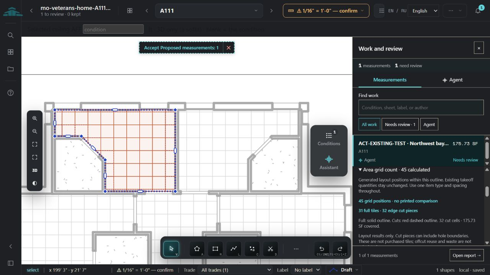

# Full tiles and edge cuts on public A111

This is the square-module evidence snapshot. The subsequent
[2-by-4 comparison](../area-grid-rectangles/README.md) adds rectangular pitches
without rewriting these recorded inputs and results.

The existing public ceiling bay now has an opt-in calculation that separates
**31 full tiles** and **32 edge cut pieces**. Clipped coverage is **175.73 SF**.
The previous 45-center count, measurement ID, source polygon, stored area and
review state remain unchanged. No tile EA is added to the takeoff or order.

This is work on the fork's `codex/area-grid-count` branch. No new upstream PR,
issue or comment is posted. It continues the [editable footprint example](../area-grid-footprints/README.md)
and does not claim to complete the broader ceiling work in
[#661](https://github.com/Kentucky-ai/opentakeoff/issues/661).

## Source and arithmetic

The source is [St. Louis Veterans Home, A111](https://oa.mo.gov/sites/default/files/bid-opportunities/_U2607-01%20-%20Final%20Plans.pdf),
also in the [public-sheet library](../../../demo/public-sheets/README.md).
This test reuses the existing northwest bay in the northern wing; it does not
retrace it. The [source manifest](../area-grid-footprints/source.json) records
the seven boundary vertices, source file hash, grid origin and calibration.
The plan legend allows existing 2-by-2 or 2-by-4 grid. This example retains the
assumed nominal 2-foot square module inferred from this bay's drawn lines;
actual tile face dimensions and joints remain unverified. The scale remains
agent-set and unconfirmed.

| Calculation | Before | After |
|---|---:|---:|
| Centers within the boundary | 45 | 45 |
| Stored measured area | 175.73 SF | 175.73 SF |
| Full tiles | Unavailable | 31 |
| Edge cut pieces | Unavailable | 32 |
| Cut cells | Unavailable | 32 |
| Full-module coverage | Unavailable | 124 SF |
| Cut-piece coverage | Unavailable | 51.7269333333 SF |
| New measurement records or approvals | 0 | 0 |

All 63 intersecting modules are considered, including modules whose centers
lie outside the boundary. The existing center count has a different meaning
and is not replaced. The nominal module area is 4 SF; 31 times 4 plus
51.7269333333 equals 175.7269333333 SF, which rounds to the existing stored area.

[oracle.py](oracle.py) independently clips the public polygon against each
module using exact rational arithmetic and only Python's standard library.
[expected.json](expected.json) records every expected cell and retained area.
The application's JTS calculation agrees cell by cell. The oracle is specific
to this simple public bay; disconnected fragments and holes have separate
geometry tests, not an unsupported general claim about the oracle.

## Review workflow

Select the existing area in **Work and review**, click **Show on plan**, expand
**Area grid count** and **Item footprint**, then select **Calculate full tiles
and edge cuts**. Click **Save grid**. Full modules have solid outlines; cuts
have red dashed outlines, so the distinction does not rely on color alone.
**Edge cut schedule** lists each cut cell, its connected piece count and its
retained SF. Cell keys are derived row/column references, not measurement IDs.

Use **Square**, zero **Edge clearance (in)**, and rectangle width and depth
equal to **Spacing (in)**. Nominal modules include their grid pitch. Unsupported
settings give a reason and disable saving; the MCP call refuses without
mutation. Undo restores the prior configuration. Project archive save/reopen
retains the option and recalculates the same result.

The alternatives considered are the [earlier full footprints](../area-grid-footprints/ceiling-original-ui.jpg),
a numeric summary alone, and clipped outlines plus the summary and optional
schedule. The implemented third option makes edge pieces inspectable against
the source. It costs more geometry work and drawing detail. The overlay caches
its calculation while only zoom changes; human speed and preference are unverified.

## Evidence and reproduction



The [browser recording](public-cut-flow.gif) shows enabling cuts, saving the
grid, **Show on plan** and zooming. It uses consecutive actual browser frames,
played three times slower with a final hold; it is not a review-speed study.
[recording.json](recording.json) records the capture timing.

| Changed surface or check | Evidence |
|---|---|
| Cut option in Item footprint | [Controls](ceiling-cut-controls.jpg) |
| Full/cut overlay and saved result | [Reopened public bay](ceiling-summary.jpg) |
| Per-cell cut schedule | [Expanded schedule](ceiling-cut-schedule.jpg) |
| Unsupported module dimensions | [Save disabled with explanation](unsupported-layout.jpg) |
| Bundled sample workflow | [Reopened AF101 example](demo-reopened.jpg) |
| Exact Undo, archive reopen and original workspace restoration | [Executable assertions](verify.mjs) |

The screenshot and recording index, local build hash and completed gates are
recorded in [checks.json](checks.json). [MCP overlay](ceiling-cuts.png) shows the
same clipped geometry as the browser. [transcript.json](transcript.json) records
actual stdio calls with local paths redacted. [ceiling-calculation.json](ceiling-calculation.json)
contains the derived geometry for inspection, not new saved measurements.

```sh
python docs/evidence/area-grid-cuts/oracle.py
node docs/evidence/area-grid-cuts/replay.mjs /absolute/path/output
node docs/evidence/area-grid-cuts/verify.mjs
npm run check --prefix web
npm run typecheck --prefix mcp
npm test --prefix mcp
npm run check --prefix protocol
npm run check:tool-count --prefix mcp
npm run check:wiki --prefix mcp
npm run build --prefix mcp
npm run smoke:dist --prefix mcp
node scripts/check-doc-links.mjs
```

The replay reads `takeoff://wiki`, loads the bundled public PDF and imports the
previous editable ceiling example. It adds only `area_grid.cut_pieces: true`,
checks unchanged reports and records, exports an editable project archive and
checks exact Undo. The bundled AF101 exercise uses an explicitly assumed
4-foot module on the existing 128 SF demonstration area: eight full modules
and zero edge cuts. It is not work specified on that finish plan.

For browser reproduction, back up the current workspace, open `ceiling-before.otk`
from the replay output, enable and save cuts, inspect **Show on plan** and the
schedule, then export and reopen a project archive. Archive loading replaces
the current workspace; JSON import merges. Repeat on `demo-before.otk`.

## Preservation and limits

- The current browser SET project is backed up in [live-baseline.json](live-baseline.json)
  before tests. No CLG skill, memory, customer drawing or private catalog data
  is used. This is a continuation of the disclosed public trace, not a blind
  takeoff. Previous footprint results were intentionally seen and reused.
- Only the boolean option is persisted. Cut geometry, counts and areas are
  derived. The source record, ID, stored quantities, original machine geometry,
  calibration and review state do not change. No automatic acceptance occurs.
- A cut cell can produce several disconnected pieces; these are separate
  **edge cut pieces**. A hole in a connected piece remains a hole in that piece.
  A mere boundary touch contributes no piece. Geometry is never repaired to
  make the count succeed.
- The shared engine works in rotated grid feet and returns normalized sheet
  polygons. It uses the existing JTS dependency. It refuses invalid topology,
  more than 5,000 boundary vertices or more than 2,500 candidate modules.
  Floating-point noise tolerance is the larger of module area times 1e-10
  and 64 machine epsilons times boundary area. Tiny noise is not a tile cut.
- Only contiguous square modules are supported. Rectangular lattices,
  staggered tiles, separate joints, fixture penetrations not traced as holes,
  stock cutting, kerf, offcut reuse, waste, hangers and purchasing totals remain
  outside this increment. Nominal cut geometry is not a fabrication schedule.
- Static marked-PDF and quantity-report exports still omit the derived grid
  and cuts; editable JSON, `.otk`, browser and MCP overlays carry the option or
  its calculation. No public hosted deployment is changed.
- Before upstream submission, agree on scope and branch dependencies, link
  the contributor's own CLA agreement and run CI on that proposed head. Local
  test results are not a claim of maintainer approval or completed GitHub CI.
