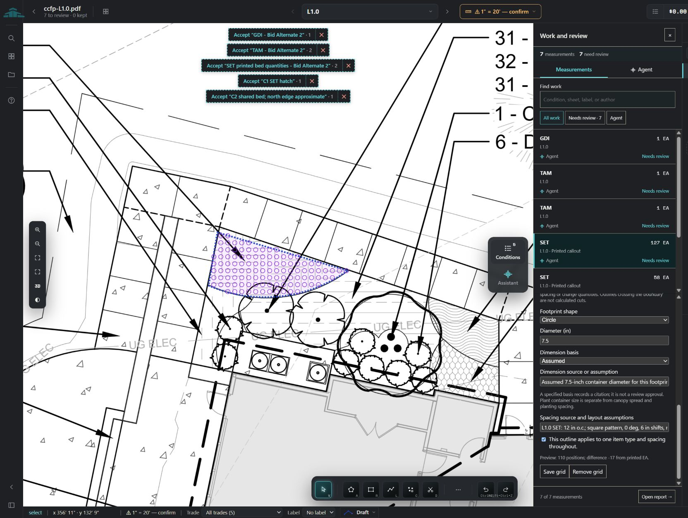
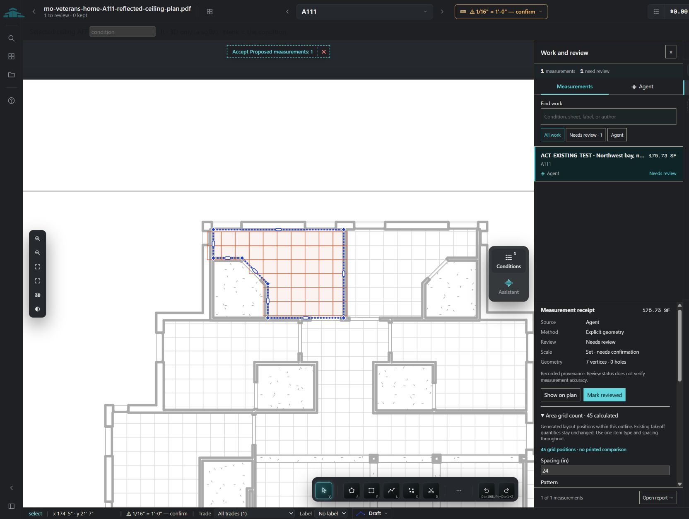
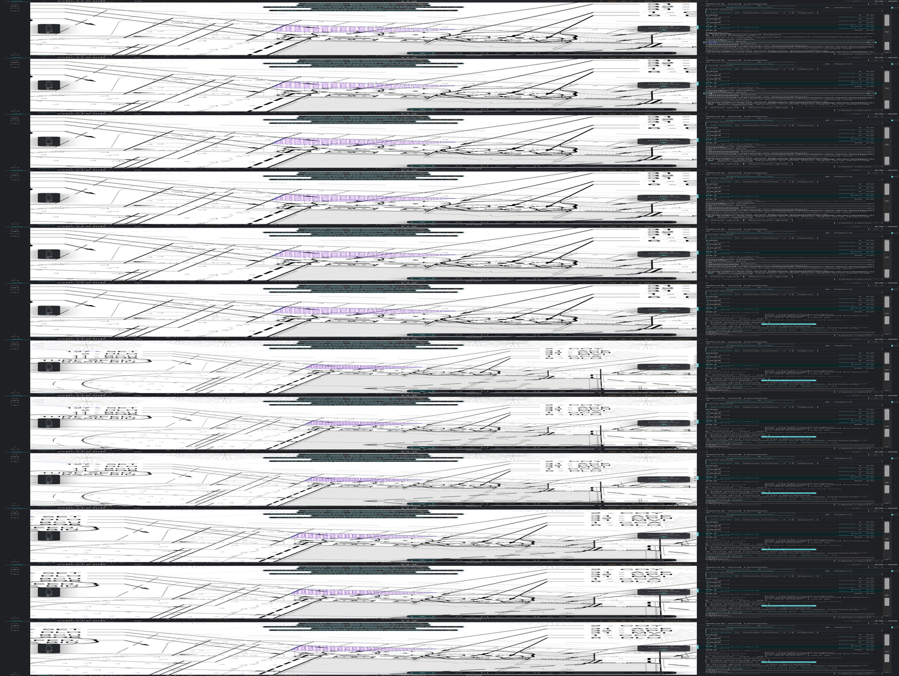

# Editable area grid footprints

You can give existing grid positions an editable circle or rectangle, drawn to
physical scale. Footprint dimensions stay separate from spacing. The same
configuration works in the browser and MCP `edit_shape` and survives project
archive reopen. It does not add measurements, change takeoff quantities, approve
work or calculate cut pieces.

This is fork-only work on `codex/area-grid-count`, continuing the
[area grid example](../area-grid-count/README.md). No new upstream PR is opened.
The public examples are planting and an existing ceiling bay; this is not a
completed ceiling-layout or purchasing tool.

## Public examples and observed results

| Example | Input and expected result | Observed result |
|---|---|---|
| L1.0 SET bed | Same 12-inch square spacing, origin, offsets and boundary; add an assumed 7.5-inch circle | 110 positions before and after; printed 127 EA unchanged |
| L1.0 alternative | Change only square to triangular; keep 12-inch spacing, 0-degree angle, 6-inch shifts and zero edge clearance | 129 positions; printed 127 EA unchanged; alternative undone |
| Public A111 ceiling bay | Existing 24-inch square grid; add an assumed nominal 24-by-24-inch module outline | 45 centers before and after; measured 175.73 SF unchanged |
| A111 browser edit | Change footprint depth to 12 inches, save, then Undo | Still 45 centers; Undo restores 24-by-24 inches |
| Bundled AF101 | Assumed 4-foot support grid and 24-by-12-inch footprint; change width to 18 inches, then Undo | Still eight positions and 128 SF; no specified support work claimed |
| Persistence | Save each example as `.otk`, reopen and use **Show on plan** | Complete before/after JSON equality for all three examples |

The SET reference is [CCFP Nature Center Addendum 1, PDF page 58, L1.0](https://www.champaignforests.org/Portals/0/adam/Content/6doWEpGR10S4Upy-igoSYw/Link/_26_0216_CCFP%20Nature%20Center%20Addendum%20No%201.pdf).
Its [verified schedule crop](../planting-suite/screenshots/schedule-set.png)
specifies 1 Gal. and 12-inch on-center spacing. The 7.5-inch container diameter
is a declared test assumption, not a value read from this plan or a universal
container standard. It is not canopy spread.

The ceiling source is [St. Louis Veterans Home, A111](https://oa.mo.gov/sites/default/files/bid-opportunities/_U2607-01%20-%20Final%20Plans.pdf),
available in the [public-sheet library](../../../demo/public-sheets/README.md).
The test traces one northwest bay in the northern wing against existing wall
and gypsum-ceiling linework. The [legend](ceiling-legend.png) allows existing
2-by-2 **or** 2-by-4 grid. This bay's drawn lines support a nominal 2-foot module;
tile face dimensions and joints remain unverified. Coordinates, scale and the
source trace are in [source.json](source.json).

## How to compare 110 and 129 with printed 127

Read the schedule, planting detail and applicable notes before selecting a
pattern. A quantity being closer does not establish which layout the designer
specified. The planting detail's pattern has not been verified in this example.

If the source leaves the pattern unstated, record alternatives with every other
input fixed. Here square is 17 below the printed quantity; triangular is two
above it. Investigate the boundary, exclusions, calibration, origin, edge rules
and source detail before explaining the discrepancy. Do not vary spacing or
offsets until the answer happens to equal 127. Retain the printed quantity and
the assumptions for review.

The agent supplies documented inputs through MCP. The shared deterministic
engine rotates the polygon into the grid frame, generates candidate centers,
excludes holes and centers outside the boundary or edge clearance, then counts
the remaining centers. Triangular rows are staggered by half the spacing and
separated by spacing times the square root of three divided by two. The model
does not estimate the arithmetic or optimize a match. The saved SET example
retains its original square pattern; 129 remains a comparison, not an adopted
quantity.

## Review flow and visual choices

Select the existing measurement, click **Show on plan**, expand **Area grid
count**, then **Item footprint**. Choose **Circle** or **Rectangle**, enter its
dimensions and their source or assumption, and click **Save grid**. Inspect the
outline against the source linework. Undo restores the previous configuration.
**Position markers only** removes the footprint when you save.

| Approach | Benefit | Tradeoff and status |
|---|---|---|
| Existing position markers | Quick indication of center placement | Do not represent item dimensions; retained as the default |
| Filled physical footprints | Could emphasize coverage | Could conceal source symbols; considered only, not built or tested |
| Physical outlines | Show dimensions and edge crossings while keeping the source visible | Chosen implementation; overlapping edges can look like a continuous grid |

The earlier [position-marker screenshot](../area-grid-count/public-grid.png)
and these actual-app captures document the change. They are not UI mockups.

| SET circle and editing controls | Public ceiling module outlines |
|---|---|
|  |  |

[SET triangular alternative](set-triangular-ui.jpg),
[ceiling rectangular edit](ceiling-edited-ui.jpg),
[bundled-plan edit](demo-footprint-ui.jpg), and
[bundled-plan reopen](demo-reopened-ui.jpg) cover the remaining changed states.
[MCP SET square](set-square.png), [MCP SET triangular](set-triangular.png) and
[MCP ceiling](ceiling-footprints.png) cover the second renderer.



The recording contains consecutive browser captures taken during actions.
[Timing and actions](recording.json) disclose playback slowed three times, with
a minimum 100 ms per frame and a held final frame. It is not a speed study.

## Preservation and reproduction

The browser project was backed up before testing. [baseline.json](baseline.json)
records its seven measurement IDs, five condition IDs, geometry, quantities,
source references, calibration and review decisions. The only lasting project
change is explicit grid metadata on the existing C1 bed, including its new
footprint. Saving converts that bed's legacy `planting_grid` to `area_grid`;
Undo in the MCP test restores the exact legacy original. There is no default
format migration. The other SET callout and shared bed remain untouched.

[verify.mjs](verify.mjs) compares all preserved fields and exact browser reopen
exports. [browser-final.json](browser-final.json) is the final editable SET
takeoff. The `set`, `ceiling` and `demo` before/after reopen JSON pairs are the
actual browser downloads, not reconstructed expected files.

```sh
node docs/evidence/area-grid-footprints/replay.mjs /absolute/path/ccfp-L1.0.pdf /absolute/path/output
node docs/evidence/area-grid-footprints/verify.mjs
npm run check --prefix web
npm run typecheck --prefix mcp
npm test --prefix mcp
npm run build --prefix mcp
npm run smoke:dist --prefix mcp
npm run check:tool-count --prefix mcp
npm run check:wiki --prefix mcp
npm run check --prefix protocol
node scripts/check-doc-links.mjs
```

[replay.mjs](replay.mjs) reads `takeoff://wiki` and calls actual stdio MCP tools.
[transcript.json](transcript.json) contains inputs and results with local paths
redacted. It uses the existing SET baseline; it measures the ceiling bay anew.
Replays create fresh IDs for that new ceiling example, while edits preserve IDs
within each run. The committed JSON records the IDs from the captured run.

For browser reproduction, open each generated `.otk` through **Open plans** in
a backed-up or empty workspace. A project archive replaces the workspace;
ordinary JSON import merges. Select the row, use **Show on plan**, edit the
footprint, save, Undo, export the archive, reopen it and repeat **Show on plan**.
The bundled sample is an explicitly assumed demonstration zone on a real finish
plan; it is not evidence that the plan specifies a support grid.

## Notes for a future reviewer

- Tested in the Codex in-app browser at `http://127.0.0.1:5200`, using the local
  production build `index-D0e5fea0.js`. Its SHA-256 and local checks are in
  [checks.json](checks.json). The hosted application was not updated.
- No CLG skill, memory, customer drawing or private catalog data was used.
  The existing public SET takeoff and its prior 110/129 comparison were seen
  and intentionally preserved. Issue #655's discussion included another
  contributor's ceiling results; those values were not used to derive this
  fresh A111 bay. This is a continuation test, not a blind takeoff benchmark.
- MCP coordinates use full-sheet image pixels at render scale 2. Persisted
  geometry and origin use normalized sheet coordinates. Dimensions are stored
  in feet, edited in inches, and scaled with the existing calibration. Both
  examples retain their unconfirmed agent-set scales.
- The engine places centers; footprints do not change which centers fit.
  Full outlines crossing the boundary stay visible. Border cells whose centers
  lie outside are absent. Therefore **45 centers is not 45 ceiling tiles**.
- Circle outlines use 48 segments with exact cardinal dimensions. Rectangles
  rotate with the grid. Independent X/Y spacing, clipped cells, offcut reuse,
  cut quantities, perimeter counts and hanger rules remain outside this change.
  A 2-by-4 footprint does not itself create a 2-by-4 spacing lattice.
- JSON and `.otk` preserve the footprint. Static marked-PDF export still omits
  generated grid positions and footprints. [Export crop](ceiling-marked-export.png)
  confirms that limitation; the measured area remains. Quantity reports keep
  their existing EA, SF and LF and omit the grid comparison.
- Negative tests reject missing or nonpositive dimensions and missing source
  basis. Exact-output tests cover renderer coordinates, scale, rectangular
  rotation, unchanged centers, import/export, archive persistence and Undo.
  Human preference and review-speed improvement remain unverified.
- Before any upstream submission, agree on the feature's scope and branch
  dependencies with maintainers, link the contributor's own CLA agreement and
  run CI on that proposed head. The broader ceiling work in
  [#661](https://github.com/Kentucky-ai/opentakeoff/issues/661) includes layout,
  cuts and hangers; this experiment does not claim to complete it.
