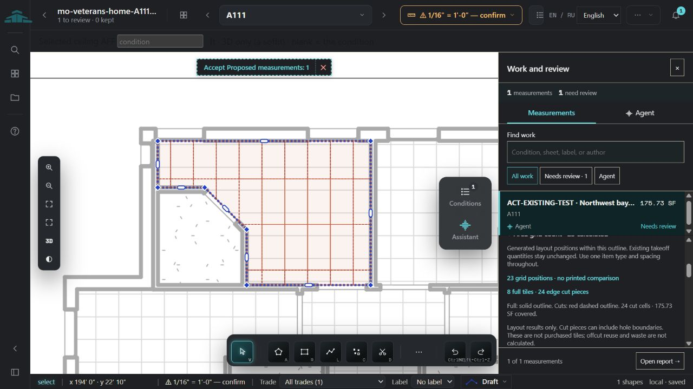
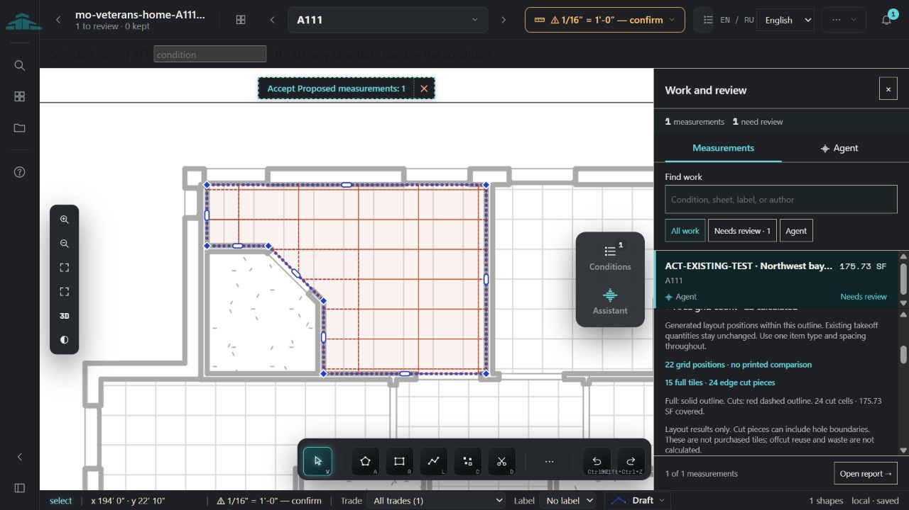

# Rectangular ceiling modules on public A111

Area grid count now supports rectangular X/Y pitches. A nominal 2-by-4 tile uses
**Rectangular**, **Spacing X (in)** 24, **Spacing Y (in)** 48, footprint width
24 in and depth 48 in. **Calculate full tiles and edge cuts** clips all
intersecting modules, including modules with centers outside the boundary.
Full tiles have solid outlines; cuts have red dashed outlines and a per-cell
schedule. These are layout pieces, not purchased tiles.

This work stays on the fork's `codex/area-grid-count` branch. No new PR,
issue or comment is posted. It continues the [square-module example](../area-grid-cuts/README.md).

## Public source and assumptions

Source: [St. Louis Veterans Home A111 reflected ceiling plan](https://oa.mo.gov/sites/default/files/bid-opportunities/_U2607-01%20-%20Final%20Plans.pdf),
also in the [public-sheet library](../../../demo/public-sheets/README.md).
The [existing source manifest](../area-grid-footprints/source.json) identifies
the source hash, seven boundary vertices and calibration. The same northwest
bay is reused; it is not retraced. The legend permits existing 2-by-2 or 2-by-4
grid; the prior trace inferred 2-by-2 from this bay's lines. **The new 2-by-4
layouts are assumed alternatives, not a claim that this bay specifies them.**
Tile face dimensions and joints remain unverified. Scale stays agent-set and
unconfirmed. Origin, one-foot shifts and zero clearance stay fixed in both
alternatives; only the stated pattern, Y pitch, depth and angle change.

| Same public boundary | 2-by-2 baseline | 2-by-4, 0 degrees | 2-by-4, 90 degrees |
|---|---:|---:|---:|
| Full tiles | 31 | 8 | 15 |
| Edge cut pieces / cut cells | 32 / 32 | 24 / 24 | 24 / 24 |
| Derived centers inside the boundary | 45 | 23 | 22 |
| Covered area | 175.7269333333 SF | 175.7269333333 SF | 175.7269333333 SF |
| Stored measured area | 175.73 SF | 175.73 SF | 175.73 SF |
| New measurements or approvals | 0 | 0 | 0 |

[oracle.py](oracle.py) uses Python's exact rational arithmetic independently of
JTS. [expected.json](expected.json) records cell classifications and retained
areas for both orientations. It checks this simple bay, not arbitrary holes or
split fragments; separate geometry tests cover those cases.

## Browser evidence

| 2-by-4 at 0 degrees | 2-by-4 at 90 degrees |
|---|---|
|  |  |

The screenshots show the actual local app after archive reopen. Both retained
the same measurement ID and pending review. The
[before screenshot](ceiling-square-before.jpg) shows the existing square layout.
The [recording](public-rectangular-flow.gif) shows **Save grid**, **Show on plan**
and zooming, using consecutive actual browser frames. Playback is slowed three
times with a final hold; [capture timing](recording.json) is disclosed and is not
a review-speed study.

| Changed surface or check | Evidence |
|---|---|
| Rectangular pattern and X/Y pitch controls | [Controls](rectangular-controls.jpg) |
| Separate full tiles and clipped outlines | Reopened screenshots above; MCP [0-degree overlay](ceiling-0.png) and [90-degree overlay](ceiling-90.png) |
| Retained area and piece count per cut cell | [Cut schedule](cut-schedule.jpg) |
| Footprint/pitch mismatch refuses saving | [Disabled save and explanation](mismatched-pitch.jpg) |
| Bundled AF101: 14 full tiles, 4 cuts, unchanged 128 SF | [Reopened sample](demo-reopened.jpg) |
| Exact Undo, preserved records, save/reopen | [Executable assertions](verify.mjs), [checks and build identity](checks.json) |

The browser project was backed up before loading either example and restored
exactly afterward. The tests clicked neither **Mark reviewed** nor **Accept**.
Only the explicit layout configuration changes in the example files. Existing
IDs, geometry, stored EA/SF/LF, calibration, source records and review decisions
remain equal to the baseline. No PDF or project archive is committed; the replay
creates editable `.otk` files locally. **Open plans** loads those archives;
back up your current workspace first because the takeoff is replaced.

## Workflow and design choice

Select the existing area in **Work and review**, click **Show on plan**, open
**Area grid count**, and choose **Rectangular**. Enter the X/Y pitches above,
open **Item footprint**, and enter matching width/depth. Keep the assumption
citations explicit. Click **Save grid**. Use **Angle (degrees)** under
**Orientation and edges** to compare 0 and 90 degrees. Do not choose an
orientation only because it produces fewer cuts; the drawing and installation
requirements govern that choice.

The options were to stretch only the footprint on the old square lattice,
derive lattice pitch silently from the footprint, or expose independent X/Y
pitches. The third is implemented: it avoids overlaps and makes the layout
assumptions reviewable. The cost is another spacing field and a requirement
that contiguous cut modules match both footprint dimensions. No automatic
layout optimization or inferred orientation is introduced.

Changing pitches recalculates derived grid centers and cuts. It does not change
stored EA/SF/LF, IDs, original geometry, source references, calibration or review.
Undo restores the exact prior grid. Existing square and triangular inputs keep
their original output; no migration or automatic default is added.

## Reproduction and limits

```sh
python docs/evidence/area-grid-rectangles/oracle.py
node docs/evidence/area-grid-rectangles/replay.mjs /absolute/path/output
node docs/evidence/area-grid-rectangles/verify.mjs
npm run check --prefix web
npm run typecheck --prefix mcp
npm test --prefix mcp
npm run check --prefix protocol
npm run check:tool-count --prefix mcp
npm run check:wiki --prefix mcp
npm run build --prefix mcp
npm run smoke:dist --prefix mcp
node scripts/check-doc-links.mjs
```

The replay uses actual MCP stdio tools and the existing public takeoff. It
exports separate editable archives for both orientations and checks exact Undo
and unchanged reports. [transcript.json](transcript.json) records actual stdio
tool calls with local paths redacted. The bundled finish-plan exercise is a labeled nominal
2-by-4 layout on the existing 128 SF area, not specified finish work.

No CLG skill, memory, customer drawing or private catalog data is used. Previous
public traces and evidence are intentionally reused; this is not a blind takeoff.
The work uses shared runtime geometry, not skill-provided arithmetic.

Contiguous square or rectangular modules only: no staggered tile pattern,
separate joints, stock cutting, kerf, offcut reuse, waste or purchasing total.
Invalid topology, more than 5,000 boundary vertices or 2,500 candidate modules
refuses without geometry repair. Holes require explicit traced holes; fixture
symbols alone do not subtract area. Static marked-PDF/report exports still omit
the derived grid and cuts. Older clients may reject rectangular patterns; full
backward visual compatibility is not claimed. Human preference and review speed
are unverified. Local checks are not GitHub CI or maintainer approval. Scope,
branch dependencies and the contributor's CLA link still need upstream review
before any future PR submission.
