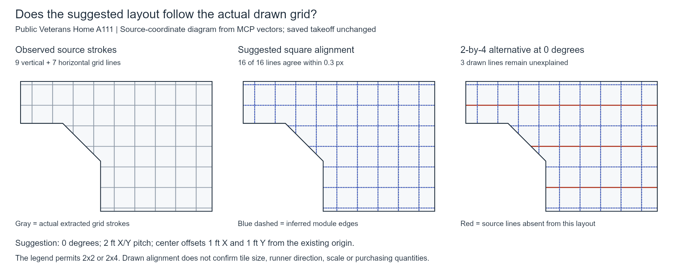

# Reading a ceiling grid with existing MCP tools

The existing MCP tools expose enough source linework to suggest the alignment
of this public ceiling bay. The observed grid supports **0 degrees, 2-foot X/Y
pitch and 1-foot X/Y center offsets from the existing origin**. The suggestion
stays in [suggestion.json](suggestion.json); it is not applied to the takeoff.
The previous 2-by-4 alternatives remain unchanged.

The later [applied-alignment browser test](../area-grid-aligned/README.md) applies
this suggestion in a separate editable example at the user's request and
verifies **Show on plan**, save, reload and archive reopen. This source-reading
trial's original before/after files remain unchanged.

This is an **agent interpretation of actual MCP vector output**, with a small
reproducible evidence script for the arithmetic. It is not a new MCP tool or a
shipped automatic ceiling-grid detector. No app, schema, suite or runtime
behavior changes in this addition. Work stays on the fork's
`codex/area-grid-count` branch, with no new PR, issue, comment or deployment.



The diagram uses actual extracted coordinates. It is not an application
screenshot. The [unmarked source crop](source.png) and [legend crop](legend.png)
are actual `view_sheet` outputs with `overlay: false`.

## Public source and result

Source: [St. Louis Veterans Home A111 reflected ceiling plan](https://oa.mo.gov/sites/default/files/bid-opportunities/_U2607-01%20-%20Final%20Plans.pdf),
available through the [public-sheet library](../../../demo/public-sheets/README.md).
The extracted A111 PDF hash is
`e9f66a799fdf094ff7b3d43f79acc8d0af9cf53773e992d451f97ddceed91ad3`.
The existing northwest-bay trace and calibration come from the
[previous public experiment](../area-grid-rectangles/README.md).
Coordinates are full-sheet image pixels on a 5184-by-3456 frame, with a top-left
origin and Y down. The query region is `[1850,175,2050,330]`.

| Check | Expected from inspected source | Observed |
|---|---|---|
| Complete raw-vector read | No dropped or unconsumed candidates | 267 returned, 0 dropped, no next page |
| Grid families within the existing bay | Two perpendicular repeated families | 9 vertical and 7 horizontal lines |
| Median distance between grid lines | Equal X/Y pitch visible in source | 18 px in both directions |
| Orientation | Horizontal and vertical lines | 0 degrees; 90 degrees is equivalent for a square |
| Grid-edge reference | First observed X and Y lines | `[1883.76,197.28]` px |
| App center offsets from the existing origin | Half a pitch from those edges | 1 ft X and 1 ft Y |
| Agreement with square layout | All selected lines within source tolerance | 16/16; maximum error 0.24 px |
| Best 2-by-4 phase at 0 degrees | Some drawn lines have no counterpart | 13/16 lines explained |
| Best 2-by-4 phase at 90 degrees | Some drawn lines have no counterpart | 12/16 lines explained |
| Nearby gypsum soffit | No regular ceiling-grid suggestion | 9 source strokes, 0 matching grid candidates; withheld |
| Existing saved project | No changes | Complete imported/before/after JSON equality |

At the retained scale of 1/9 foot per pixel, 18 pixels is 2 feet. The scale is
agent-set and **unconfirmed**. Two vertical source lines deviate by 0.24 pixel,
or 0.32 inch at that scale. The fit uses a disclosed 0.3-pixel tolerance; it does
not claim exact registration of every stroke.

The legend permits both 2-by-2 and 2-by-4 ceiling grid and tiles. This bay's
drawn grid has equal pitch in both directions. That supports a square alignment
suggestion, but does not resolve tile procurement size, physical face, joints
or main-runner direction. The earlier 2-by-4 layouts are still labeled assumed
alternatives. Choosing fewer cuts or matching a target quantity cannot resolve
this source ambiguity.

## How the MCP workflow works

1. Read `takeoff://wiki`, load the public PDF and import a copy of the existing
   public takeoff into an isolated MCP session.
2. Use `sheet_info` to establish the coordinate frame and retained calibration.
   Use `read_sheet_text` and `view_sheet` on the legend to check module wording.
3. Use `get_sheet_vectors` on the bay and consume every returned page. These
   are raw PDF strokes, not classified ceiling lines. This sheet has a small
   image area; the repeated strokes are present in the vector output and are
   checked against the unmarked source crop.
4. Inspect the source crop and select its light-gray grid family. In this bay
   it has pen bucket 1, luminance 216 and no curve, clipping or fill-only flags.
   Keep only strokes whose midpoints lie inside the existing bay. This
   analyst-selected style is source-specific, not a general classifier.
5. Fit the two line families without supplying the saved angle, pitch or
   offsets. Only after fitting, read the existing origin to express the result
   in the app's coordinates. Source strokes are **tile edges**; the app's
   offsets locate **tile centers**, so add half a module before converting.
6. Write an unapplied suggestion with stroke indices, residuals and ambiguities.
   Export the session again and compare every field with the imported baseline.

[transcript.json](transcript.json) records the actual MCP calls with local paths
redacted. [vectors.json](vectors.json) preserves the raw return, and
[selected-strokes.json](selected-strokes.json) identifies the 16 used strokes.
[fit.mjs](fit.mjs) contains evidence-only arithmetic;
[analyze.mjs](analyze.mjs) performs the scoped interpretation. It never calls
`edit_shape`, creates a measurement or grants approval.

No additional MCP verb is needed to perform this agent-assisted trial. A future
one-call reader would still need broader real-sheet cases, candidate
classification, region boundaries, raster/OCR handling and explicit withholding
for ambiguous layouts. This one bay does not validate those capabilities.

## Preservation and reproducibility

The measurement remains `shp-1db5dfa0-f9ae-489a-8bd3-0e4ec9ba067a`, and the
condition remains `cnd-99390bdb-e86a-4c25-8b9c-48effdb33b08`. Saved area
**175.73 SF**, perimeter **60.4 LF**, vertices, calibration, original source
records, grid settings and pending review all remain equal. No EA quantity is
created. [before.json](before.json) and [after.json](after.json) are identical as
parsed JSON and equal to the imported previous 2-by-4 example. No browser
workspace is connected, loaded or changed during this read-only MCP test.

Run from the repository root with the web and MCP dependencies installed:

```sh
node docs/evidence/area-grid-source/replay.mjs tmp/area-grid-source-replay
node docs/evidence/area-grid-source/analyze.mjs tmp/area-grid-source-replay
node docs/evidence/area-grid-source/plot.mjs tmp/area-grid-source-replay
node docs/evidence/area-grid-source/verify.test.mjs tmp/area-grid-source-replay
node --test docs/evidence/area-grid-source/verify.test.mjs
npm run check --prefix web
npm run check:tool-count --prefix mcp
npm run check:wiki --prefix mcp
npm run check --prefix protocol
node scripts/check-doc-links.mjs
```

The replay verifies the PDF hash and exact imported/before/after equality.
Analysis writes a separate suggestion into the output directory. The committed
fixture tests check the known public source coordinates, the real neighboring
gypsum negative case, a deliberately wrong phase, missing/shifted strokes and
an explicitly synthetic 23-degree rectangular grid. The synthetic case checks
angle/phase arithmetic; it is not additional public-plan evidence.
[checks.json](checks.json) records the tested source revision and results.

The public source and previous public layouts were already seen. This is a
fresh vector read and fit on a reused bay, **not a blind takeoff**. No CLG skill,
CLG memory, customer plan, private catalog or external takeoff script is used.
No actual-app recording is added because no app surface or flow changes here;
the [prior browser evidence](../area-grid-rectangles/README.md#browser-evidence)
still documents the existing controls. No review-speed, broad detection accuracy
or purchasing-quantity claim is made. These local checks are not human approval
or GitHub CI results.
