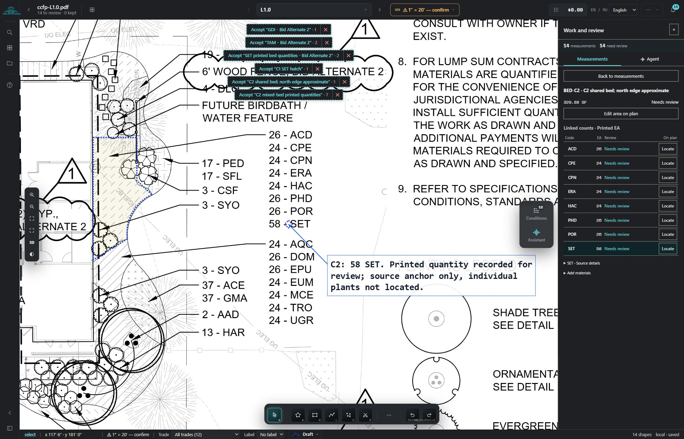
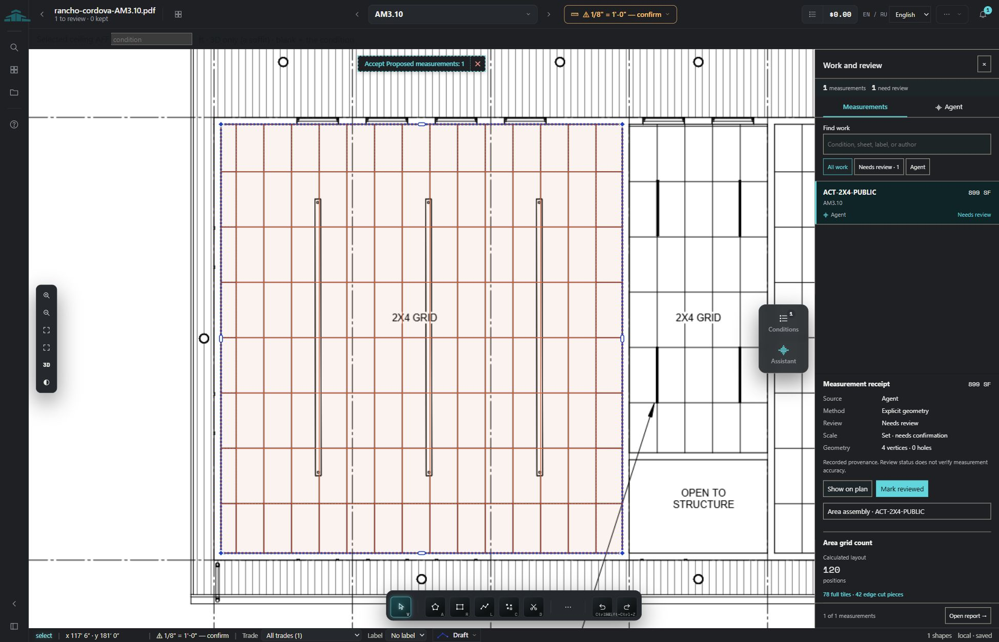

# Area grid and assembly review

**Start with the planting bed.** A landscape estimator needs to see where a
printed plant quantity belongs, check it against its source, and use the same
outline for soil layers and edging. One bed can contain one repeated plant or
several species. Drawing a new outline for every output duplicates work;
inventing individual plant points from a printed quantity loses its meaning.

This fork explores two reusable features. **Area grid count** compares a
calculated layout with the source without replacing the takeoff quantity.
**Area assembly** groups existing material rows, linked printed EA and derived
LF under their area. The public planting examples led to tests of square and
rectangular ceiling modules. Paving, bioretention and trenches are related
uses to investigate, not completed examples.

This is a review packet for `65monroe/opentakeoff`,
`codex/area-assembly-prototype`, checked November 22, 2026. It opens no PR and
does not change the hosted app. Earlier evidence folders are dated snapshots;
use the current-state descriptions below before following their detailed logs.

## What to review first

| Example | What it demonstrates | Verified result and qualification | Evidence |
| --- | --- | --- | --- |
| CCFP L1.0, C1 single-species hatch | A layout comparison inside the existing bed | 110.50 SF; 127 printed SET EA; 110 square or 129 triangular positions. Triangular pattern and 7.5-inch container footprint are assumptions. Neither replaces 127 EA. | [Current note and reopen](../c1-spacing-note/README.md), [footprint and pattern comparison](../area-grid-footprints/README.md) |
| CCFP L1.0, C2 mixed bed | Several printed sources share one editable outline | Eight separate codes total 232 printed EA, including 58 SET. No species grid or individual plant positions are invented. The north boundary remains approximate. | [Source and arithmetic](../mixed-bed-callouts/README.md), [compact rows and flow](../compact-bed-review/README.md) |
| C1 material/edge demonstration | Different units from the same bed | Two separate assumed 4-inch layers give 1.36 CY each; existing 127 plant EA; separate derived edging 48.17 LF. | [Native assembly baseline](../area-assembly-prototype/README.md), [inch-depth editing](../area-assembly-depth/README.md) |
| Veterans Home A111 square grid | Read drawn alignment, then calculate whole modules and cuts | 175.73 SF; 31 full tiles and 32 edge cut pieces. Source lines support 2-foot pitch; nominal tile face and procurement size remain unresolved. | [Vector interpretation](../area-grid-source/README.md), [applied alignment and reopen](../area-grid-aligned/README.md) |
| Rancho Cordova AM3.10 actual 2-by-4 grid | Unequal axes on a source labeled 2X4 GRID | 899 SF; 78 full tiles and 42 edge cut pieces. Independent 8 × 15 cell arithmetic; no purchased-tile total. | [Source, hand calculation and persistence](../area-grid-actual-2x4/README.md), [current compact panel](current-ceiling-summary.jpg) |
| Bundled AF101 | Exercise the same controls outside planting | Explicitly assumed 128 SF layout zone: 8 positions; 2 in the wider-spacing draft. Material recipe and Cancel also tested. These are test inputs on a real plan, not specified finish work. | [Bundled controls and preservation](../compact-bed-review/README.md#browser-verification) |

The material/edge demonstration is a **separate archive** from the 14-record
C1/C2 mixed-bed project. The latter has no saved C2 soil rows or edging.
Do not combine their totals or imply that every illustrated output is already
in one delivered job. The records and their review decisions stay intact.



*Actual local app: all eight printed sources remain accessible from one bed.*



*Actual local app, November 22: the compact panel retains 78 full tiles and
42 edge cut pieces. Source-derived alignment is a proposal, not human approval.*

## How the review workflow changed

The estimator selects an area, checks its outputs, locates a source or boundary,
and returns to the same area. The earlier panel repeated source text and
buttons for every plant. Grid settings competed with the saved result.
The compact panel shows code, EA, review state and **Locate** together. One
selected source expands for its reference and label. The grid shows the saved
comparison first; **Adjust grid** opens a draft with optional details.

[Design alternatives](options.html) compares stacked rows, compact rows and
focused review, plus three ways to present grid settings. These are clearly
labeled schematic mockups using the public example's values. The recommended
compact approach is implemented; focused review and the grid wizard are not.
[The side-by-side exhibit](options.jpg) is suitable for attaching to a future
design discussion. No mockup is presented as an application screenshot.

Compact rows keep several quantities visible together. The tradeoff is one
extra selection/disclosure to read a source or edit its label. A summary-first
grid preserves the saved result while the operator explores a draft; it also
puts uncommon inputs behind disclosures. The user's preference supports this
choice. Human timing, broader estimator preference and mobile layout remain
unverified; there is no claim of faster review.

The [earlier actual assembly flow](../area-assembly-panel/public-bed-flow.gif)
and [current compact flow](../compact-bed-review/public-bed-flow.gif) show
public-plan navigation and draft cancellation. The
[depth flow](../area-assembly-depth/depth-edit-flow.gif) shows direct inch entry.
These clips encode actual browser captures with timing manifests linked in
their guides; playback is slowed and the compact clip omits a gap. They are
not uninterrupted screen recordings or controlled before/after timing tests.

## Existing capability, new work and MCP

| Layer | Responsibility |
| --- | --- |
| Existing core | Measure SF, EA and LF; save material recipes; calculate coverage; derive a boundary run; report, export and review records |
| Earlier fork prerequisites | Planting method, reviewable printed quantities and explicit area/source links. A callout anchor identifies source text, not an installed plant. |
| Area grid increment | Shared deterministic positions, footprints and full/cut module intersections; browser editing and MCP `edit_shape area_grid`; no additional count records |
| Assembly panel increment | A view and editor over native condition material rows, linked printed counts and derived runs; direct inch entry converts to existing SF-per-CY coverage |
| Agent/MCP workflow | Read schedule/text/vectors and inspect the drawing; propose supported settings with citations and assumptions; call the shared engine rather than ask the model to do layout arithmetic |
| Reviewer | Check extent, scale, sources and discrepancies. The tools do not mint human approval. |

The existing [acoustical-ceiling suite](../../wiki/suites.md) already calculates
module-based tile quantities, runners, tees, hangers and wall angle. This fork
adds a visible, source-aligned layout with full modules and clipped pieces;
it does not replace that suite or supply its missing procurement rules.

The ceiling alignment examples use actual `get_sheet_vectors` output with
source-specific, agent-selected strokes and an evidence-only fitting script.
They do not ship an automatic grid reader. The 129-position triangular SET
layout is not selected by minimizing its difference from 127: closeness alone
does not establish a specified pattern. The note now states the assumption.

This audit uses repository guidance, public fixtures and their disclosed prior
results. No CLG skills, memory, private catalogs or customer plans are used.
It is a continuation of public examples, not a blind fresh takeoff or a test of
the unmodified published server. The [original planting increment and upstream-core comparison](../planting-suite/BASELINE-RESULTS.md)
and [fork increment](../planting-suite/RESULTS.md) keep that distinction visible.

## Contribution checklist and future split

Reviewed against the current [contribution rules](../../../CONTRIBUTING.md#the-evidence-bar),
[repository guide](../../wiki/repo-guide.md),
[PR template](../../../.github/PULL_REQUEST_TEMPLATE.md), and the
[maintainer's options/workflow/public-sheet request](https://github.com/Kentucky-ai/opentakeoff/pull/660#issuecomment-6998470824).
The existing [human CLA comment](https://github.com/Kentucky-ai/opentakeoff/issues/659#issuecomment-6985194643)
is linked; this audit posts nothing on the contributor's behalf.

| Requirement | Evidence or remaining step |
| --- | --- |
| Explain the problem and alternatives | Planting rationale above; labeled options exhibit, recommendation and tradeoffs |
| Public source, real flow, bundled sample | Six bounded examples above; original URLs/hashes in their manifests; actual-app stills and capture sequences |
| Every changed surface | [Surface index](SURFACES.md), including invalid input, sources, cuts, material editor, report and export limitation |
| Exact output and negative cases | [Re-run the fixture gates](verify.mjs); full-project comparisons and public cut oracles; source misalignment, missing links, bad geometry/rates and mutation controls |
| Source-backed docs | README, FEATURES, USER_GUIDE, AGENT_GUIDE, MCP guidance, field inventory and generated references are linked in the surface index |
| Clean evidence | [File audit](file-audit.json): nested Markdown links, JSON parsing, artifact types and path/credential-pattern scan; [media integrity](media-audit.json) and visual inspection of the primary exhibits. Source PDFs and editable archives stay local. |
| Required checks | [Local check results](checks.json); these are not upstream CI or maintainer acceptance |
| One concern per PR | This branch is an integration stack. Do not submit its entire diff as one feature PR. Prepare bounded dependent patches below when submission is authorized. |
| Agreement for significant UI/tool changes | #659/#583/#617/#661 provide related proposals, not approval of this specific implementation. Keep future submissions draft while maintainers review the scope/options. |

Suggested boundaries: first the planting/printed-source prerequisites; then
**Area grid count** (layout, footprints, cuts, MCP and public planting/ceiling
tests); separately **Area assembly review** (native materials, depth editing,
linked sources and derived LF). The compact UI commit touches both panels and
must be split by file/hunk when preparing independent patches. This audit does
not rewrite branches or create PRs. The stack starts after `8a31fb4`; the
assembly work starts after `ec47b31`. A future PR needs a fresh upstream
comparison and CI on its actual proposed head.

Related work: [planting #659](https://github.com/Kentucky-ai/opentakeoff/issues/659),
[assemblies #583](https://github.com/Kentucky-ai/opentakeoff/issues/583),
[sitework #617](https://github.com/Kentucky-ai/opentakeoff/issues/617), and
[ceilings #661](https://github.com/Kentucky-ai/opentakeoff/issues/661).
Use related-work links, not closing keywords. This work does not supply nested
kits, balanced ceiling borders, runners/hangers, fixture deductions or the
Hendersonville answer-key/3D evidence required to finish #661.

## Reproduce and open

From the checkout with Node 24 and installed web/MCP/protocol dependencies:

```sh
node docs/evidence/area-review/verify.mjs
node docs/evidence/area-review/audit.mjs
npm run check --prefix web
npm run typecheck --prefix mcp
npm test --prefix mcp
npm run build --prefix mcp
npm run smoke:dist --prefix mcp
npm run check:tool-count --prefix mcp
npm run check:wiki --prefix mcp
npm run check --prefix protocol
node scripts/check-doc-links.mjs
```

For optional media integrity verification, install Pillow in your test
environment and run `python docs/evidence/area-review/media-audit.py`.
After repeating the UI flow described in [browser-checks.json](browser-checks.json),
place its five local exports in `tmp/area-review-audit/` using the names in
[verify-browser.mjs](verify-browser.mjs), then run that script. It compares
complete records and original PDF bytes; it does not operate the browser.

The source download/extraction and actual stdio MCP replay commands are in
each example guide. The [portable package command](package.mjs) builds the
current 14-record planting archive from the linked original public addendum
(hash checked, L1.0 extracted) and the corrected C1 JSON; it does not mint IDs
or add materials. For example:

```sh
node docs/evidence/area-review/package.mjs path/to/public-addendum.pdf tmp/public-beds.otk
```

Full `.otk` archives contain PDFs and remain outside Git. Export a backup first,
then use **Open plans**. Archive loading replaces the takeoff but can retain
other PDFs already in the browser; JSON import merges. Use a genuinely separate
browser workspace for a fresh review. Another tab alone is not separate.

## Notes for the reviewer

- MCP input polygons use full-sheet image pixels at render scale 2. Saved
  vertices/origins are normalized; grid dimensions and offsets use feet.
  The browser edits inches. Clipping runs in grid-local feet and returns
  normalized polygons. Calibration remains agent-set and unconfirmed.
- Grid centers, intersecting cells, connected cut pieces and ordered units
  mean different things. Edge-crossing modules can count even when their
  centers lie outside. No offcut reuse, waste, joint, kerf or stock optimization
  is inferred. Static marked PDFs and ordinary reports omit the derived grid
  and cut results; editable archives and on-screen/MCP overlays carry them.
- Native material recipes apply to conditions. The bed editor guards shared
  conditions and material families; use the condition editor for that scope.
  Edging is a snapshot, not an automatically recalculated dependency. Boundary
  changes require deliberate review of that run.
- Bioretention layers can share an outline only when their extents agree.
  Varying depths, side slopes, trench sections and paver joints/bonds are
  untested here. They need their own inputs and public evidence.
- C2's approximate boundary, source ambiguities, pending reviews, proposal
  banners and excess precision in ceiling shift inputs remain visible. No
  measurements are accepted to improve screenshots. No production claim is made.
