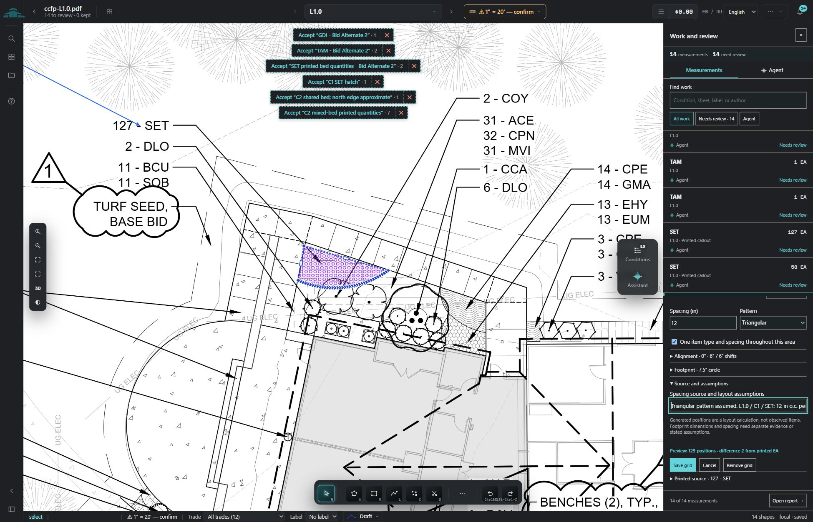

# C1 triangular-layout assumption note

The public C1 bed already uses a triangular grid. Its old reference still said
square. This correction changes only that existing grid reference:

> Triangular pattern assumed. L1.0 / C1 / SET: 12 in o.c. per schedule; 0 deg rotation, 6 in X/Y shifts and no edge clearance assumed. Calculated layout, not observed plant positions.

The 12-inch schedule spacing is separate from the assumed triangular layout.
The calculation is not evidence of individually located plants and does not
replace the printed quantity. No spacing, pattern, rotation, shift, footprint,
boundary, quantity or review setting changes.

## Browser verification

Tested November 22, 2026 in the existing Codex in-app browser, tab 6,
`http://127.0.0.1:5200/`, build asset `/assets/index-DeAp0Zrx.js`. This is the
fork build from `37f568b3484bac4b0937b6ea8fca8c3127fdb4d3`; no application code
changes are needed for this correction.

1. Export fresh JSON and `.otk` backups. The fresh project matches the previous
   compact-panel delivery exactly: 14 measurements, 12 conditions, all 14 pending.
2. Select **BED-C1 · C1 SET hatch**, then **Adjust grid → Source and assumptions**.
3. Replace **Spacing source and layout assumptions** with the text above and
   click **Save grid**. Export JSON and the full project archive.
4. Reload and export JSON again. Reopen the saved `.otk` through **Open plans**,
   select C1, click **Show on plan**, and reopen **Source and assumptions**.
5. Read the persisted field and export again. The reopened note matches exactly,
   and Save is disabled because there is no draft change. Cancel closes the editor.



| Value | Before | After reload and reopen |
| --- | ---: | ---: |
| C1 area | 110.50 SF | 110.50 SF |
| C1 printed SET | 127 EA | 127 EA |
| C1 generated positions | 129 | 129 |
| C2 printed SET | 58 EA | 58 EA |
| C2 area | 329.88 SF | 329.88 SF |
| Measurements / conditions | 14 / 12 | 14 / 12 |
| Measurements pending review | 14 | 14 |

[verify.mjs](verify.mjs) compares the entire project against the fresh
[baseline](baseline.takeoff.json), allowing exactly one field change:
`shapes[shp-7cca5e9f-60ef-4215-a544-54d3c5e5055a].area_grid.reference`.
The [corrected project](corrected.takeoff.json),
[reload export](after-reload.takeoff.json), and
[reopen export](after-reopen.takeoff.json) are identical.
[browser-result.json](browser-result.json) records the displayed values and note.

```sh
node docs/evidence/c1-spacing-note/verify.mjs
node scripts/check-doc-links.mjs
```

Checks passed on November 22, 2026: `npm run check --prefix web` (3,863
passed, four skipped, zero failures; lint has three existing warnings),
`npm run check:tool-count --prefix mcp`, `npm run check:wiki --prefix mcp`,
`npm run check --prefix protocol` (64 passed), and the doc-link check.
The project comparison also passed with `--browser`.

With the local backups available, append `--browser` to also compare each
archive's project and every stored PDF's SHA-256. All match apart from the
intended note. The editable archive is kept locally as
`tmp/c1-spacing-note/public-bed-triangular-note.otk`; PDFs are not committed.
Open that archive through **Open plans** after backing up the current workspace.
The JSON is also editable, but a normal JSON import is a merge, not a full load.

The [public source manifest](../planting-suite/source.json) and
[prior compact-panel evidence](../compact-bed-review/README.md) remain unchanged.
This is a project-data and evidence correction on `65monroe/opentakeoff`, branch
`codex/area-assembly-prototype`. No new PR, merge, deployment, CLG skill or memory
is used. Triangular placement remains an assumption; no human approval is claimed.
