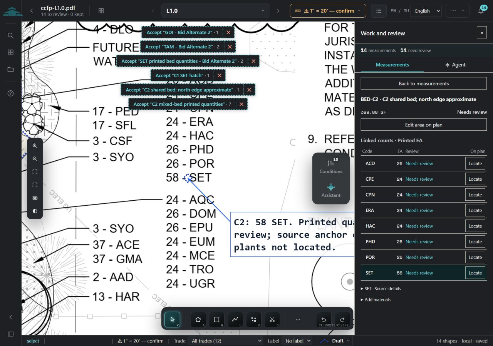
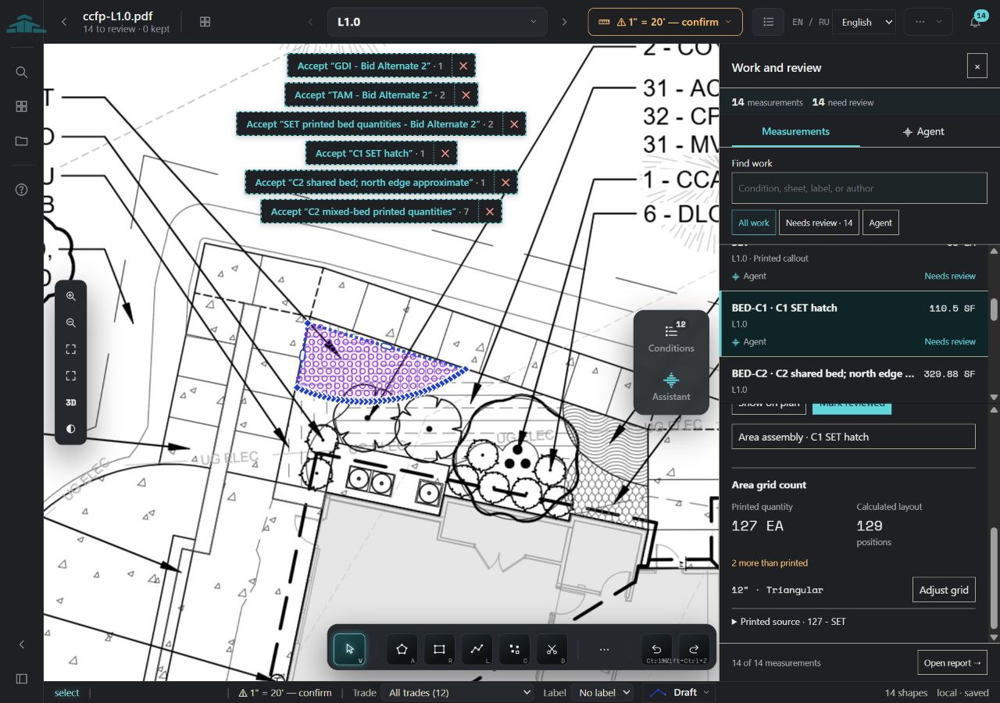
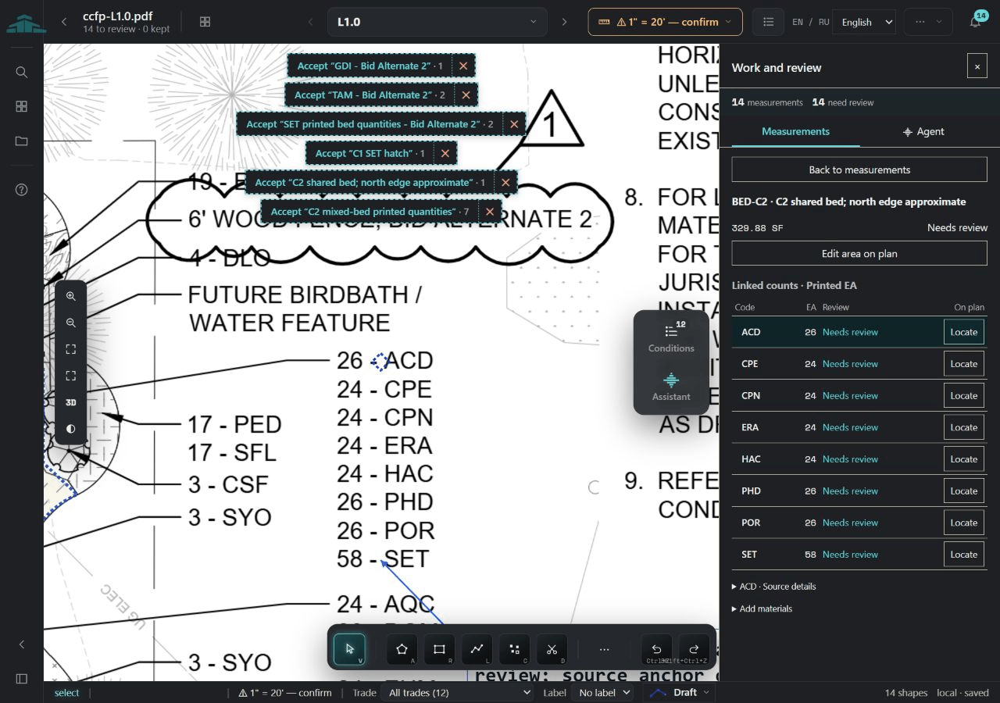

# Compact bed review and grid settings

The C1 source-note mismatch recorded below was subsequently corrected in the
[triangular-layout note follow-up](../c1-spacing-note/README.md). These captures
and baseline exports retain the original trial state.

Review a shared bed in compact code, EA, review and **Locate** rows. Select a
code for one expandable **Source details** section. Empty material controls
collapse under **Add materials**; existing materials and derived lengths keep
their editors. The grid starts with saved results and **Adjust grid**, with
alignment, footprint and source details collapsed until needed.

This is a UI-only follow-up on `65monroe/opentakeoff`, branch
`codex/area-assembly-prototype`, starting at `9665b635761390519db630ddcdedc09fd6d095ea`.
It does not add an MCP tool, change the calculation engine or introduce persisted
fields. No new PR, upstream deployment, CLG skill, memory, customer drawing or
catalog data is part of this work.

## Options and review task

The task is to compare eight printed quantities with one mixed bed, inspect a
source without losing the bed, then inspect a single-species layout separately.
The earlier panel repeats a source disclosure, two buttons and review text for
every code. Its grid editor exposes most settings immediately.

| Option | Benefit | Tradeoff |
| --- | --- | --- |
| Existing stacked rows | Every row has all actions nearby | Eight records require substantial scrolling |
| Compact rows — implemented | Quantities and review states share a table; Locate keeps bed context | Source details and Edit label require selecting a row and expanding one section |
| Focused review — mockup only | One source at a time with next-code navigation | More navigation when comparing several codes |

The user chose compact rows after comparing interactive mockups. The grid
follows the same approach: saved results first, optional editors on demand.
This is a preference decision, not a measured review-speed improvement.

## Public examples and baseline

Use the public CCFP Nature Center Addendum 1, PDF page 58, sheet L1.0. The
[source manifest](../planting-suite/source.json) identifies the source URL,
revision and hash; [mixed-bed evidence](../mixed-bed-callouts/README.md) records
the existing eight source anchors. This increment does not perform another takeoff.

The fresh browser backup has 14 measurements and 12 conditions, all 14
measurements pending review. C2 has 329.88 SF and eight printed quantities:
ACD 26, CPE 24, CPN 24, ERA 24, HAC 24, PHD 26, POR 26 and SET 58 EA. These are
printed sources, not observed individual plant locations. C2's approximate
north boundary remains visible in its label; no grid is inferred for that bed.

C1 retains 110.50 SF, 127 printed SET and the browser's existing triangular
12-inch grid with 129 calculated positions. **Pre-existing source-note mismatch:**
the stored reference still says square. This follow-up preserves the settings
and note verbatim; it does not resolve that source assumption or force agreement
with the printed quantity. Its 7.5-inch footprint is an assumption.

## Browser verification

Tested November 21, 2026 in the Codex in-app browser, existing tab 6,
`http://127.0.0.1:5200/`, with a 1280 × 900 desktop viewport. The preview serves
the fork's production build, `/assets/index-DeAp0Zrx.js`, SHA-256
`2f7f1f159714719296665d612bfa9388359e900b98335e74798242a72f9c8742`.
The viewport override was reset after testing. No console errors were recorded.
The production website is unchanged.







The recording encodes consecutive actual UI captures at 1.8 seconds per frame
for readability. The gap between source navigation and the grid sequence is
omitted. [recording.json](recording.json) records the actions and capture times;
this is not a timing study. The earlier
[stacked panel](../mixed-bed-callouts/04-reopened-SET.jpg) provides the before view.

| Check | Expected | Observed |
| --- | --- | --- |
| C2 source navigation | Same eight codes, EA, IDs and pending decisions | All eight match; Locate selects each code and source; bed context stays open |
| C1 summary | 127 printed EA, 129 saved positions | 127 / 129, difference +2 |
| C1 square draft | 110 positions; saved layout unchanged | 110 preview, 129 saved; Cancel restores triangular |
| Invalid spacing / incompatible cuts | Save disabled; no silent correction | Zero spacing rejected; triangular cuts rejected with off switch still available |
| No-op / footprint Save and Undo | No-op Save disabled; Undo restores exact record | Verified; all 14 records match baseline afterward |
| Reload and full `.otk` reopen | Exact JSON and stored PDF bytes | Exact match after navigation, Cancel, reload, reopen and final restoration |
| Existing material/edge example | 1.36 CY per 4-inch layer, 127 EA, 48.17 LF | Preserved; 5-inch compost draft previews 1.71 CY, Cancel changes nothing |
| Bundled AF101 assumed layout | 8 saved positions, 2 at 96-inch draft spacing | Verified; Cancel preserves the whole bundled project |

Additional changed surfaces: [source/label disclosure](03-source-label.jpg),
[C1 source](04-c1-source.jpg), [grid settings](05-grid-settings.jpg),
[validation](06-grid-invalid.jpg), [footprint/cut draft](07-footprint-draft.jpg),
[alignment](08-alignment.jpg), [source assumptions](09-assumptions.jpg),
[reopened C2](11-reopened-c2.jpg), [existing materials](14-existing-materials.jpg),
[existing edging](15-existing-edge.jpg), [bundled grid](16-bundled-preview.jpg),
and [bundled assembly](17-bundled-assembly.jpg). Cut results on C1 are a temporary
UI test, not a planting specification; they were never saved.

1. Export fresh JSON and project-archive backups before loading the changed build.
2. Open C2's **Area assembly**. Check all eight code/EA/review rows and the boundary
   qualification. Use each **Locate** button and verify the source text and ID.
3. Select a code and expand **Source details**. Preview a label edit and Cancel.
4. Open C1's grid. Check 127 printed EA versus 129 calculated positions. Open
   **Adjust grid**, change a draft, Cancel, and reopen to check saved values.
   Exercise footprint, alignment, cut-option visibility and invalid-input feedback.
5. Export, reload and reopen the `.otk` through **Open plans**. A JSON merge or
   another tab is not a separate workspace. Compare every project field, not
   only totals; retest source navigation after reopening.
6. Exercise the existing assumed layout on the bundled
   `demo/sample-finish-plan.pdf`, then restore the public-bed archive.

## Reproduce

```sh
npm ci --prefix web
npm run check --prefix web
npm run check:tool-count --prefix mcp
npm run check:wiki --prefix mcp
npm run check --prefix protocol
node scripts/check-doc-links.mjs
node docs/evidence/compact-bed-review/verify.mjs
node docs/evidence/compact-bed-review/encode-recording.mjs
```

Run the browser flow in a backed-up workspace on the fork's local build. Public
PDFs and `.otk` archives remain outside Git. The ordinary JSON evidence and
actual UI captures are suitable for review. No approval controls are used.
The verification script's optional `--browser` flag also checks the local archive
backups and stored PDF bytes. [checks.json](checks.json) records the passing
web gate (3,863 passed, four skipped), 64 protocol tests, tool-count/wiki/doc-link
checks and preservation gate. These are local checks, not a claim about GitHub CI.

## Reviewer notes

- No coordinate conversions change. Existing normalized vertices and source
  anchors still drive the existing locator; selecting a table row is UI state.
- IDs, measured quantities, geometry, scale, source references and review states
  must match the fresh browser baseline after testing and restoration.
- A shared source is labeled **Shared** and is not allocated or summed into
  multiple beds. Missing sources remain visible. Material-family and shared
  condition restrictions still use the existing area-assembly logic.
- The grid's saved result stays separate from its draft numeric preview. Cancel
  and Close settings unmount the editor, discarding every draft input. Save uses
  the existing shape command. No-op drafts cannot be saved.
- Cut controls are hidden for circle/position-only layouts unless cuts are
  already enabled, so an invalid configuration can still be turned off. Engine
  errors remain visible and disable Save; no incompatible setting is silently cleared.
- Static marked PDFs and report exports retain the existing grid limitations.
  Human acceptance, field accuracy and review speed are unverified.
- The existing proposal banners remain above the drawing. Mobile visual layout
  remains unverified; desktop behavior is the verified evidence here.
