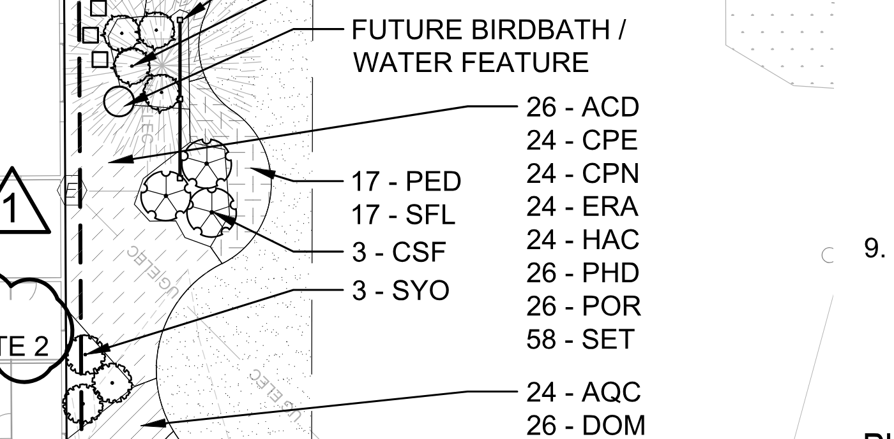
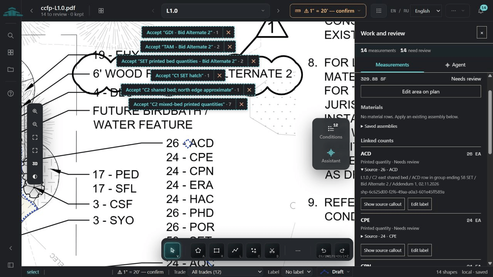

# Eight printed quantities on one shared bed

Current scope, compact UI and checks: [area review packet](../area-review/README.md).
The source records below are preserved; the later panel uses compact rows.

The public C2 bed now links ACD, CPE, CPN, ERA, HAC, PHD, POR and the existing
58 SET in the same **Area assembly** panel. Each code has its own printed EA,
source anchor, reference and pending review record. This adds example data
using the fork's existing tools and panel; it does not change application code.

Branch: `65monroe/opentakeoff` → `codex/area-assembly-prototype`.
Application baseline: `4503f97b622bc9782299f45c9b89bd3d0436ef7a`.
No new PR, issue comment, upstream push or deployment is part of this work.
This extends the planting example for [#659](https://github.com/Kentucky-ai/opentakeoff/issues/659)
and the [existing assembly panel](../area-assembly-panel/README.md), which discusses
[#583](https://github.com/Kentucky-ai/opentakeoff/issues/583) and
[#617](https://github.com/Kentucky-ai/opentakeoff/issues/617).

## Source and arithmetic

Source: [CCFP Nature Center, Addendum 1](https://www.champaignforests.org/Portals/0/adam/Content/6doWEpGR10S4Upy-igoSYw/Link/_26_0216_CCFP%20Nature%20Center%20Addendum%20No%201.pdf),
PDF page 58, L1.0, Bid Alternate 2, revision 02.11.2026.
The [source manifest](../planting-suite/source.json) records the PDF hash.
[source.json](source.json) records this callout's exact rows and image coordinates.



| Printed code | EA | Record | Source-button evidence | Show on plan evidence |
|---|---:|---|---|---|
| ACD | 26 | Added | [ACD source](source-ACD.jpg) | [ACD bed](plan-ACD.jpg) |
| CPE | 24 | Added | [CPE source](source-CPE.jpg) | [CPE bed](plan-CPE.jpg) |
| CPN | 24 | Added | [CPN source](source-CPN.jpg) | [CPN bed](plan-CPN.jpg) |
| ERA | 24 | Added | [ERA source](source-ERA.jpg) | [ERA bed](plan-ERA.jpg) |
| HAC | 24 | Added | [HAC source](source-HAC.jpg) | [HAC bed](plan-HAC.jpg) |
| PHD | 26 | Added | [PHD source](source-PHD.jpg) | [PHD bed](plan-PHD.jpg) |
| POR | 26 | Added | [POR source](source-POR.jpg) | [POR bed](plan-POR.jpg) |
| SET | 58 | Existing, unchanged | [SET source](source-SET.jpg) | [SET bed](plan-SET.jpg) |

New printed EA = 26 + 24 + 24 + 24 + 24 + 26 + 26 = **174**.
This bed = 174 + 58 = **232 printed EA**, separated by code.
Existing SET across both beds remains 127 + 58 = **185 EA**.
The adjacent PED/SFL/CSF/SYO and AQC/DOM/EPU groups are outside this increment.
This is not a complete sheet takeoff or a schedule reconciliation.

## Baseline and preservation

The fresh saved browser project, backed up as JSON, `.otk` and profile before
changes, contained seven shapes and five conditions. All seven were pending.
That is the [baseline](baseline.takeoff.json) used here, rather than the separate
eight-shape C1 material/edging demonstration archive. That earlier archive is
unchanged; its demonstration layers and edging were not silently merged into
the active project.

- All seven existing IDs, condition records, geometry, computed quantities,
  review decisions, calibration, annotations and source references survive.
- The sole existing-record change is BED-C2's `source_callout_ids` list and
  the MCP tool's `origin.agent_edits` counter, increased by one. Its machine
  original and pending review state remain unchanged.
- Seven new conditions and seven new pending printed-source records are added.
  No individual plant points, grids, duplicate SET counts or permanent locator
  annotations are created. Total records: **7 → 14**; linked C2 sources: **1 → 8**.
- BED-C2 remains **329.88 SF** with its original approximate north boundary.
  Its area is not divided among species. Calibration remains unconfirmed.

The quantities were read visually from fresh `view_sheet` output.
`read_sheet_text` supplied row positions, but its encoded glyph text was
unreadable; it was not treated as a trustworthy code transcription.
No CLG skill, memory, tool, catalog or customer drawing was used. Existing
public records and the fork's earlier prototypes are disclosed inputs, not a
claim that the published server already supplies this panel or workflow.

## Actual browser workflow

Tested in the Codex in-app browser, existing tab 6, `http://127.0.0.1:5200/`,
1280 × 720, Vite production preview. Loaded asset:
`assets/index-Dm6reqzM.js`, SHA-256
`7798b27f8e88f28290a3bd1bc1e2c15462465025438808f17d5d71c92822fbdf`.
The public hosted application was not changed.

1. Open the corrected `.otk` through **Open plans**. This uses the existing
   full-project archive load, not the JSON merge path that can retain older
   conditions. The original archive and profile remain available locally.
2. Open **Work and review**, choose **BED-C2**, then **Area assembly**.
   All eight source rows appear in the same scrollable panel.
3. For each row, click **Show source callout**. The locator centers on its
   printed text on L1.0 and the bed panel stays open. Expand **Source** to
   compare the printed text, reference and measurement ID.
4. Return to measurements and test **Show on plan** for each code. This action
   frames the linked bed. Use **Show source callout** for the specific text row;
   these two existing actions have different navigation targets.
5. Export JSON and `.otk`, reload the browser, export again, reopen the saved
   `.otk`, and export again. All four JSON exports match the corrected project
   exactly. The reopened panel retains all eight IDs and quantities. Retest
   the first and last source buttons after reopening.

The archive comparison initially detected different bytes in the separately
extracted L1.0 PDF. The delivered archive restores the exact PDF from the fresh
browser backup. MCP checks confirmed identical extracted text and rendered
source-crop pixels between those two extractions; the final archive comparison
also confirms all original stored PDF bytes are preserved.



The recording uses consecutive actual browser captures, slowed for readability.
[recording.json](recording.json) retains capture timestamps; no review-speed
or human-preference claim is made. [navigation.json](navigation.json) records
all source IDs, [show-on-plan.json](show-on-plan.json) records the receipts,
and [reopened-panel.json](reopened-panel.json) records the reopened rows.
See [reopened ACD](05-reopened-ACD.jpg) and [reopened SET](04-reopened-SET.jpg).

## Reproduce and check

[record.mjs](record.mjs) connects to the actual fork MCP server over stdio. It
reads `takeoff://wiki`, loads the public sheet, imports the baseline, opens the
planting suite, records the seven quantities, tests identical retries, links
the existing area, exports the report and marked PDF, and reimports to compare.
It refuses a baseline that already contains the seven codes. Within its run,
repeating each identical source tool call returns the same ID without mutation.
The tool transcript is [mcp-transcript.json](mcp-transcript.json); results are
[mcp-results.json](mcp-results.json).

```sh
node docs/evidence/mixed-bed-callouts/record.mjs SOURCE_L1.0.pdf docs/evidence/mixed-bed-callouts/baseline.takeoff.json OUTPUT_DIR
node docs/evidence/mixed-bed-callouts/package.mjs SOURCE_L1.0.pdf public-mixed-bed.otk
node docs/evidence/mixed-bed-callouts/verify.mjs
npm run check --prefix web
npm run check:tool-count --prefix mcp
npm run check:wiki --prefix mcp
npm run check --prefix protocol
node scripts/check-doc-links.mjs
```

Use a single-page extraction named `ccfp-L1.0.pdf` from the cited public PDF,
at the unchanged original page dimensions. `package.mjs` packages the committed
verified [takeoff JSON](mixed-bed.takeoff.json) with that sheet only.
New replay runs create new IDs only for their seven new records; they preserve
the baseline IDs. The committed delivery retains the IDs shown in the evidence.

The verification gate checks all original records and fields, eight links,
quantities, source coordinates, pending new reviews and report count basis.
Negative controls prove it rejects a changed old review, changed SET count,
moved bed vertex or missing source link. `verify.mjs --browser` also compares
the local browser exports, profile and stored PDF bytes against fresh backups.
[persistence.json](persistence.json) and [checks.json](checks.json) record results.

## Limits retained

The existing panel requires scrolling through eight rows. Pending-proposal
banners obscure some upper drawing context, and the bed-focused view can put
the text callout behind the side panel. The source-specific button centers the
correct text visibly. No work was accepted to clear those banners.

C2 has no saved soil material rows or derived edging run in this baseline.
This increment records printed codes and quantities; it does not add botanical
identity metadata, change the provisional outline, infer species subareas or
claim the bed contains observed individual plant positions. SF and EA remain
separate. The marked PDF is a supporting local export; the editable `.otk` and
JSON are the review deliverables. Human sign-off remains pending.
