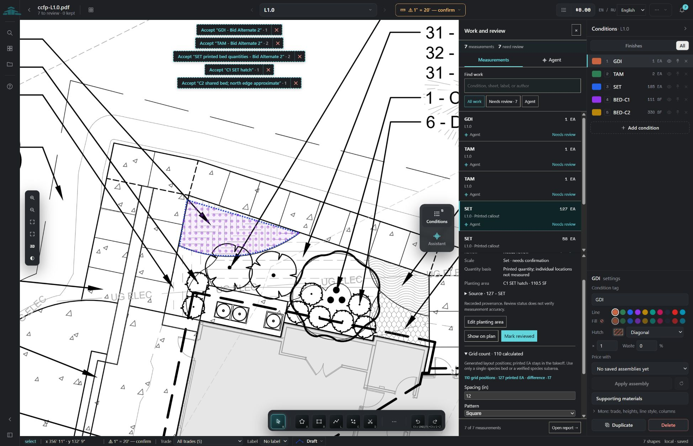

# Planting grid comparison and bed-first review

Fork-only follow-up on `codex/planting-grid-count`, based on planting-suite commit
`456c688915295930f571a94b188b72db1d69119e`. No new PR, deployment or merge.
This is separate from the planting-suite increment because it adds spacing math,
editable layout settings and a persisted field. A future PR can be split from
its parent after the linked-bed work is reviewed.

For the single-species SET hatch, review starts at the editable bed. The printed
127 EA remains its quantity source, available under **Source**, rather than a
second visible diamond competing with the bed. A spacing grid can check that
quantity without claiming that its generated positions were observed plants.



## Source and arithmetic

Use the [public source manifest](../planting-suite/source.json) and its
[verified SET schedule crop](../planting-suite/screenshots/schedule-set.png).
The source is Champaign County Forest Preserve District Nature Center Addendum 1,
PDF page 58, sheet L1.0, revision 02.11.2026, **Bid Alternate 2**:
[public PDF](https://www.champaignforests.org/Portals/0/adam/Content/6doWEpGR10S4Upy-igoSYw/Link/_26_0216_CCFP%20Nature%20Center%20Addendum%20No%201.pdf).
No customer drawing, company skill, company memory, catalog or previous private
takeoff was used. The earlier public-plan baseline is deliberately retained.

SET is **Sedum ternatum / Wild Stonecrop, 1 Gal., 12 inches o.c.** The schedule
has 185 EA; the two recorded printed quantities remain 127 + 58 = 185 EA.
No planting pattern, orientation, offset or edge clearance was verified from
the schedule. Those settings are explicit trial assumptions.

| Check on the existing C1 hatch | Expected | Observed in MCP and browser |
| --- | --- | --- |
| Printed quantity | Preserve 127 EA | 127 EA |
| Existing traced bed | Preserve 110.5 SF | 110.5 SF |
| Square, 12-inch spacing | Clipped lattice, not area rounded to EA | 110 positions; difference -17 |
| Triangular, 12-inch spacing | Alternate rows offset half a spacing; row pitch 10.3923 inches | 129 positions; difference +2 |
| Final saved configuration | Square comparison | 110 positions |

Both trials use 0-degree rotation, 6-inch X/Y shifts, zero edge clearance and a
fixed origin at the bed's original first vertex. Positions are clipped to the
outline; holes are excluded. The settings were not tuned to produce 127.
The fixed origin makes an edited edge change the included points without moving
the whole lattice. The area and printed EA remain separate units.

## Options and recommendation

1. **Source diamond only:** useful for checking transcription, but the reader
   must follow a leader to understand the planted extent.
2. **Bed first, source on demand:** implemented here. **Show on plan** frames the
   linked bed; **Source → Show source callout** reveals the existing source
   diamond. There is one editable outline and no permanent extra locator.
3. **Replace the printed quantity with generated individual counts:** deferred.
   A grid is a layout assumption, not evidence of each plant's actual location.
   Adopting it would require an explicit quantity decision and duplicate handling.

Option 2 keeps the source auditable while reducing competing marks. For C2's
mixed bed, retain one outline and eventually show a per-code quantity list in
its receipt. This sample currently records only SET 58 from that eight-code
list; the other seven codes have not been transcribed. It does not pretend that
all species have been located or allocate their portions of the shared bed.
No grid was applied to C2. A species grid there requires a verified subarea.

## Actual browser exercise

Tested the existing **Codex in-app browser** tab at `http://127.0.0.1:5200/`,
serving the local Vite production build, not the public hosted app.
Loaded entry `assets/index-rYdPxi0O.js`, SHA-256
`1aab625a9e236468d06c687797ea43eacf158ae9c0cde186a3ffcfebb6d84b03`.

The live browser project was exported as JSON and a native `.otk` backup before
changes. [baseline.json](baseline.json) contains all seven existing records.
The portable archive includes the public PDF and stays local, outside Git.

1. Select **SET 127 → Show on plan**. Confirm the C1 outline is selected and the
   linked callout diamond is hidden. Open **Grid count**, enter 12-inch spacing,
   square pattern, the declared shifts/reference, and confirm the single-species
   extent. Save: **110 grid positions · 127 printed EA · difference -17**.
2. Change to triangular and save: **129**, difference **+2**. Undo returns exactly
   to the square configuration. [Square](browser-grid-square.jpg) and
   [triangular](browser-grid-triangular.jpg) are actual app screenshots.
3. Expand **Source → Show source callout**. The original 127 source diamond
   appears; **Show on plan** returns to the bed. See [C1 source](browser-c1-source.jpg).
4. **Edit planting area**, drag its northwest vertex, observe **124.06 SF / 123
   positions**, with 127 EA unchanged. Undo restores **110.5 SF / 110 positions**.
   [Temporary edit](browser-boundary-edit.jpg) is evidence, not the saved result.
5. Select **SET 58 → Show on plan**: the shared bed is selected. Source opens
   its printed 58 and surrounding species list. See [bed](browser-c2-bed.jpg)
   and [source](browser-c2-source.jpg). The approximate north boundary remains
   disclosed; no review status was changed.
6. Export JSON and **Export project archive**. Open that `.otk` through **Open
   plans**, then repeat both SET navigation paths and inspect the saved square
   grid settings. [C1 reopened](browser-c1-reopened.jpg),
   [C2 reopened](browser-c2-reopened.jpg).
7. Export again. [Before](browser-before-reopen.json) and
   [after](browser-after-reopen.json) are deeply equal. Removing only C1's new
   `planting_grid` field gives the exact original browser baseline, including
   IDs, geometry, quantities, conditions, calibration, source references,
   annotations and review states. All seven records remain pending review.

The existing **Markup list → Hide layer** control hid the five generated notes
during inspection without deleting them. The printed PDF callouts remained
visible. The final screenshot uses two additional zoom-in clicks after Show on
plan; the locator's existing maximum zoom is unchanged. Proposal banners remain
visible because no proposal was accepted for presentation purposes.

## Reproduce and verify

Install the normal repository dependencies and obtain the exact public L1.0
page using the source manifest. Use a separate empty browser workspace: opening
an `.otk` replaces the project, and another tab at the same origin is not an
isolated workspace.

```sh
node docs/evidence/planting-grid-count/replay.mjs /absolute/path/ccfp-L1.0.pdf /absolute/path/output
node docs/evidence/planting-grid-count/verify-exports.mjs
npm run check --prefix web
npm run typecheck --prefix mcp
npm test --prefix mcp
npm run build --prefix mcp
npm run smoke:dist --prefix mcp
npm run check:tool-count --prefix mcp
npm run check:wiki --prefix mcp
npm run check --prefix protocol
node scripts/check-doc-links.mjs
```

[replay.mjs](replay.mjs) reads `takeoff://wiki`, uses actual MCP `load_plan`,
`import_takeoff`, `edit_shape`, `undo_last`, `view_sheet`, `export_takeoff` and
`export_report`. It does not manufacture MCP output or use a company helper.
See [transcript](transcript.json), [results](results.json),
[configuration](config.json), [editable takeoff](takeoff.json),
[unchanged quantity report](report.json), and [MCP overlay](grid-overlay.png).
The browser uses hollow circles; the MCP inspection overlay uses small crosses.
Both use the same calculated points. MCP configures layout through `edit_shape`;
no new tool or human-approval capability was added.

Automated tests cover square/triangular math, rotation, shifts, clearance, holes,
concave outlines, non-square page dimensions, scale changes, invalid settings,
bounded work, undo, import/archive preservation and untouched quantity/review
fields. [checks.json](checks.json) records the completed local gates.

## Limits before a PR

- This adds a comparison, not a quantity-adoption or automatic planting reader.
  Generated dots are not individual measurements and cannot be approved as such.
- Editable JSON and `.otk` preserve grid settings; the static marked-PDF and
  quantity report exports currently omit the grid comparison. The report still
  correctly retains printed EA and measured SF. Export presentation is follow-up.
- C1's traced extent and existing agent-set scale still need estimator review.
  Scale remains explicitly unconfirmed. C2's north boundary remains approximate.
- The grid refuses more than 100,000 candidates or 10,000 accepted positions,
  and refuses legacy live curved shapes; baked editable vertices are supported.
- A continuous actual-app recording, changed-surface evidence on the bundled
  demo, and human preference/review-speed feedback remain outstanding before
  presenting this as ready for maintainer review. Existing count-ring and bulk
  review PRs are not updated by this branch.
