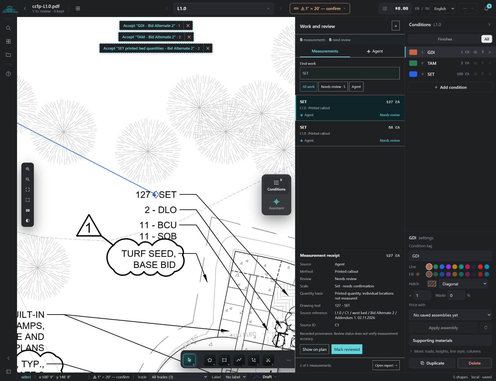
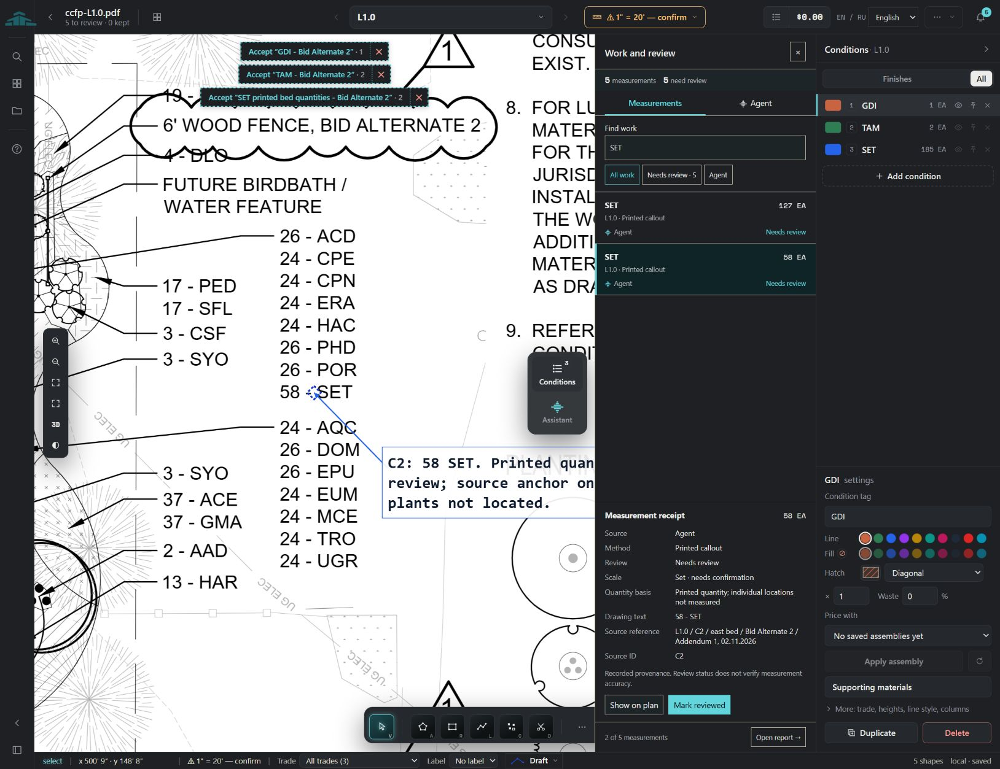

# Public SET browser test

Both printed quantities pass **Show on plan**, browser reload and reopening the
browser-exported project archive. All five measurement records and all three
conditions match the MCP baseline exactly. No record was accepted or marked
reviewed. This test verifies navigation and persistence, not human approval.

Tested on November 20, 2026 in the Codex in-app browser at
`http://127.0.0.1:5200/`, serving a local Vite preview build of
`6b14613160b3927a690270275654092d9f4bd3a2` on `codex/planting-suite`.
The loaded DOM script was `/assets/index-DnTr0fqi.js`, SHA-256
`eae9b6e75dcc8f0e92dc7f4a4b2f18a5d9c79d727ce6dff9126436cbab168486`.
These are actual browser screenshots at 1628 by 1253 pixels. The public hosted
app was not tested or changed. No application code changed during this test.

## Source and method

The [public source manifest](../source.json) identifies CCFP Nature Center
Addendum 1, PDF page 58, L1.0, revision 02.11.2026, Bid Alternate 2. The
[MCP baseline](../reviewable/takeoff.json) contains three individually located
trees and two printed SET source records. The imported archive packages that
baseline with the public PDF using the [native archive writer](../package-review.mjs).
No CLG skill, memory, private drawing, catalog or company script was used.
The earlier MCP replay used visually verified source values and explicit
coordinates; this browser test did not rerun the takeoff.

The origin was verified empty before import. An initial import failed because
the local preview server had stopped. After restarting it, a fresh tab at the
same origin loaded the archive successfully. Only the public project was used.
Archive opening replaces the takeoff and snapshots the previous state; it is
not the ordinary JSON merge. Another tab alone is not an isolated workspace.

## Expected versus observed

| Check | Expected | Observed |
|---|---|---|
| Import | 5 records; 3 conditions; all pending | Pass |
| SET C1 | 127 EA; printed `127 - SET`; west source on L1.0 | Receipt and Show on plan match the source |
| SET C2 | 58 EA; printed `58 - SET`; east source on L1.0 | Receipt and Show on plan match the source |
| Hidden SET condition | Source remains findable | Selecting C2 reveals SET before Show on plan |
| Conflicting trade filter | Source remains findable | Selecting C1 resets Landscape planting to All trades and reveals SET |
| Report | GDI 1, TAM 2, SET 185 EA | Pass; SET explicitly says `0 EA located; 185 EA from printed callouts` |
| Browser reload | Both receipts and locations persist | Pass; Show on plan repeated for both |
| Export and reopen `.otk` | Same 5 pending records and source locations | Pass; Show on plan repeated for both; report rechecked |
| Full exported records | No ID, geometry, quantity, condition, source, calibration or review changes | Exact equality to baseline; only `sheet_tabs` changes from `[]` to the opened sheet |
| Browser reports | Identical quantities and source ledger before/after | Exact JSON equality |

SET's 185 EA is 127 + 58 printed EA, not 185 located plant symbols. Its two open
diamonds identify the source text. The three trees remain independently located.
Calibration remains agent-set and unconfirmed. The schedule comparison remains
separate; the test makes no claim of a complete planting takeoff.

## Screenshots

Select an image to inspect the original capture. This is a sequence of stills,
not a continuous recording.

| Stage | West C1 — 127 EA | East C2 — 58 EA |
|---|---|---|
| Initial Show on plan | [West source and receipt](01-c1-show-on-plan.jpg) | [East source and receipt](02-c2-show-on-plan.jpg) |
| After browser reload | [West after reload](04-c1-after-reload.jpg) | [East after reload](05-c2-after-reload.jpg) |
| After exported archive reopen | [West after archive reopen](06-c1-after-archive-reopen.jpg) | [East after archive reopen](07-c2-after-archive-reopen.jpg) |





The report captures document a visibility limitation, not a visual pass:
[before reopen](03-report-quantity-basis.jpg) and
[after archive reopen](08-report-after-archive-reopen.jpg). In this dark theme,
table body text has poor contrast. The quantity-basis line is visible; the
browser accessibility text and downloaded JSON independently confirm the totals.
Whether this contrast problem also occurs upstream was not tested.

## Repeat and check

1. Follow [the reproduction commands](../README.md#reproduce) to create the public archive.
2. Run `npm run build --prefix web`, then
   `npm run preview --prefix web -- --host 127.0.0.1 --port 5200 --strictPort`.
   Use a disposable empty workspace; do not replace a customer project.
3. Click **Open plans** and choose the generated `.otk`. Open **Work and review**,
   search `SET`, select **127 EA**, and click **Show on plan**. Repeat for **58 EA**.
   Read each source reference and verify the diamond meets the matching printed text.
4. Open **Quantities report**. Check GDI 1, TAM 2 and SET 185 EA and the printed/located split.
   Choose **Export** > **JSON** to save the report.
5. Return to the canvas. Choose **Everything else** > **Export takeoff…** and
   **Export project archive…**. Wait for **saved**, reload, then repeat both source checks.
6. Click **Open plans** and open the archive saved by the browser in step 5.
   Repeat both **Show on plan** checks and the report check. Export takeoff and report again.
   Do not click **Mark reviewed** or the proposal **Accept** buttons.

The committed downloads are [before reopen](takeoff-before-reopen.json),
[after reload](takeoff-after-reload.json), [after archive reopen](takeoff-after-archive-reopen.json),
[report before](report-before-reopen.json) and [report after](report-after-archive-reopen.json).
They contain public sample data only. The PDF and `.otk` are excluded from Git.

Recheck the exact recorded downloads from the repository root:

```sh
node docs/evidence/planting-suite/browser/verify-exports.mjs
```

The [recorded comparison](persistence-check.json) includes the five IDs and
download hashes. This command checks downloaded data; it does not automate the
visible navigation assertions or manufacture a new browser run.
The [checks](checks.json) record the repeated web, protocol, inventory, wiki and
documentation gates, plus the browser-saved archive and embedded PDF hashes.

## Remaining contribution evidence

- A continuous actual-browser flow recording and the changed flow on the bundled
  sample remain outstanding. These public-plan stills do not replace either requirement.
- The dark report contrast needs follow-up before claiming the report is visually ready.
- The C2 generated annotation covers some surrounding drawing context; the printed
  source remains visible. Existing annotation geometry was preserved in this test.
- The conditions still resolve to Finishes because this MCP baseline has no
  condition `trade` setter. This test does not claim planting classification is complete.
- CSV/Excel browser downloads, approval/undo gestures, alternate browsers, human
  review speed, production behavior and a full-plan census were not tested here.

No new PR, merge, deployment, or human acceptance is implied by these results.
